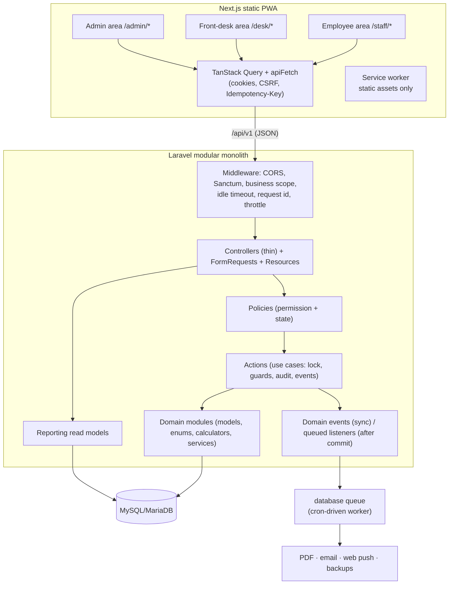
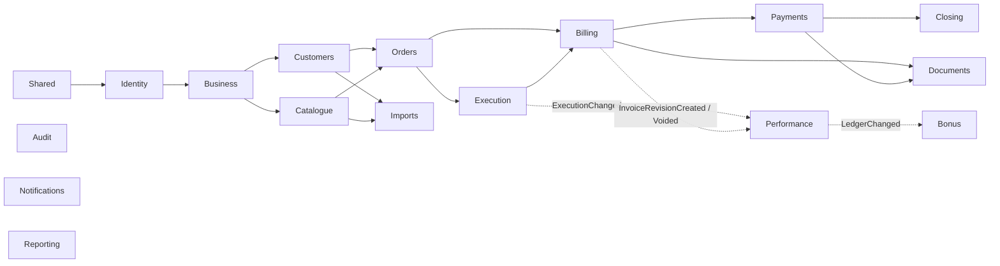
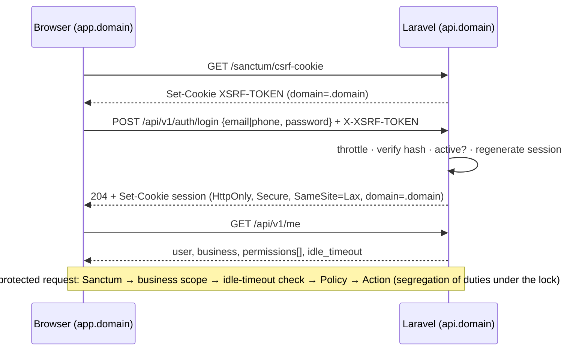
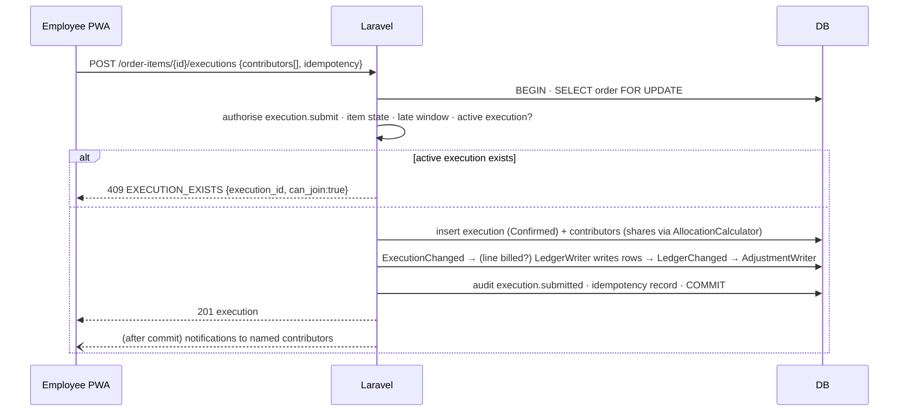
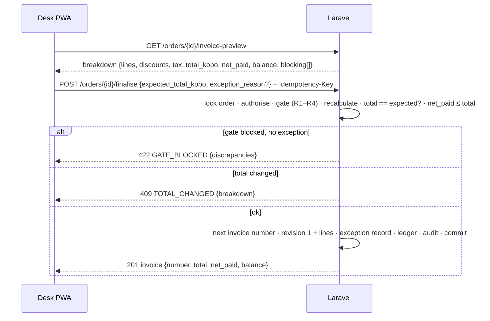
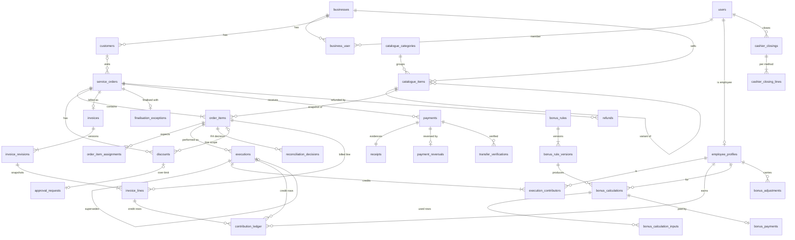
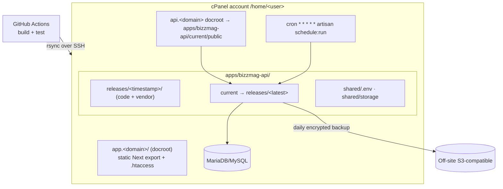

# Stage 3 — Implementation Architecture and Technical Design

**Project:** Salon Operations & Accountability Platform
**Version:** 1.0
**Date:** 2026-11-25
**Status:** Approved by the product owner on 2026-11-25, "with recommendations" (S3-D01 to S3-D07 accepted).
**Baseline:** PRD v1.4, SRS v1.2 and the Stage 2 decisions (all approved on 2026-11-25).

## Hosting assumptions

The hosting facts requested in Stage 2 §8.2 have not been provided yet. This architecture therefore assumes a **typical cPanel plan** with:

- PHP 8.3 available through MultiPHP;
- MariaDB 10.6+ or MySQL 8.0.16+;
- cron jobs that can run every minute;
- SSH access;
- subdomains;
- SMTP email.

Section 11.1 lists what changes if any of these is missing.

## Starting point in the repository

| Area | State today |
|---|---|
| `backend/` | Laravel 13 / PHP 8.3, Sanctum 4, PHPUnit. A single example `/api/user` route. Tests run on SQLite `:memory:`. |
| `frontend/` | Next.js 16.4 / React 19.3. shadcn (`base-nova`, Base UI). Tailwind via Turbopack. |
| `.github/`, `infrastructure/` | Empty. |

---

## 0. Summary

### Architecture in brief

- **One Laravel application** is the backend. It is a modular monolith with 15 business modules plus a shared kernel. It is the *only* place where business rules, money calculations and permissions live.
- **One Next.js application** is the frontend. It is built as a **static site** and has three areas:
  - an **Employee** area, mobile-first;
  - a **Front Desk** area;
  - an **Owner/Admin** area.
- The frontend talks to the backend only through the versioned REST API `/api/v1`. Authentication uses cookie sessions.
- **One MySQL/MariaDB database**, with the constraints fixed in Stage 2.
- **Hosting on cPanel:**

  | Subdomain | Serves |
  |---|---|
  | `app.<domain>` | The static frontend |
  | `api.<domain>` | Laravel |

  Background work runs from a cron entry every minute. The same build can later move to a VPS without code changes.

### Decisions in this stage that need your approval (§16)

There are 7, labelled S3-D01 to S3-D07. In summary:

- the module folder layout;
- 6 frontend packages and 3 more backend packages;
- deployment by SSH from GitHub Actions;
- off-site backups to S3-compatible storage;
- the generated API documentation.

---

## 1. Architecture Decision Records

### 1.1 Decisions carried forward

The Stage 2 TDRs remain in force:

- TDR-01 to TDR-03: money, rounding and the calculation engine;
- TDR-04: Sanctum cookie authentication;
- TDR-05: static frontend export on cPanel;
- TDR-06: cron-driven queue;
- TDR-07: dompdf;
- TDR-08 and TDR-09: locking and idempotency;
- TDR-10: gap-free numbering;
- TDR-11: audit;
- TDR-12: immutability;
- TDR-13: business scoping;
- TDR-14: keys;
- TDR-15: business day;
- TDR-16: contribution ledger;
- TDR-17: bonus versions;
- TDR-18: calculated reconciliation;
- TDR-19: enum state machines;
- TDR-20: polling notifications;
- TDR-21: spatie/laravel-permission;
- TDR-22: openspout;
- TDR-23: MySQL 8.0.16+ or MariaDB 10.6+;
- TDR-24: PWA limits.

### 1.2 New Architecture Decision Records

| ADR | Decision | Alternatives rejected | Why |
|---|---|---|---|
| **ADR-01** | **Backend module layout.** Domain code lives in `app/Domain/<Module>/`. The HTTP layer stays in Laravel's standard `app/Http/...`, grouped by module. | (a) Everything in the default `app/Models` and `app/Http` folders: rules end up scattered across 30+ models. (b) Separate packages per module: too heavy for one app. | Keeps Laravel conventions for HTTP and routing, while giving each module one obvious home. **Adds a new base folder, so it needs approval (S3-D01).** |
| **ADR-02** | **Commands as Action classes.** Each state-changing use case is one class, for example `FinaliseOrder` or `RecordPayment`. It owns the transaction, lock, guards, domain logic, audit and events. Controllers only validate, authorise and call an Action. | Fat controllers; one service class per model | Gives one tested entry point per business operation, which matches the transition tables in SRS §6. |
| **ADR-03** | **Cross-module communication.** Calls flow in one direction only (§4). Reverse effects use **synchronous domain events**, handled inside the same transaction. For example, `ExecutionChanged` leads Performance to rewrite the contribution ledger. External side effects (email, push, PDF) use after-commit queued listeners. | Direct calls in both directions, which creates cycles; asynchronous events for financial effects, which breaks atomicity | Avoids dependency cycles and keeps ledger, adjustment and audit writes atomic with the change that caused them. |
| **ADR-04** | **Read models.** Reports and the dashboard use dedicated query classes in `Domain/Reporting`. These read the ledger, invoice lines and payments directly with indexed SQL aggregates. There are no stored summary tables in the MVP. | Precomputed summary tables | At salon volume, live queries stay under 3 s (NFR-PERF-003). Nothing to keep in sync (DR-003). |
| **ADR-05** | **API contract.** OpenAPI 3.1 is generated from the Laravel code by `dedoc/scramble`. TypeScript types are generated from it with `openapi-typescript`. CI fails if the committed types are out of date. | Hand-written docs and types, which drift; GraphQL, which is unnecessary here | Gives one contract, typed frontend calls, and documentation that is always current (S3-D02/D03). |
| **ADR-06** | **Frontend data layer.** TanStack Query for server state. React Hook Form with Zod for forms. A thin `apiFetch` wrapper handles cookies, CSRF, idempotency keys and error mapping. There is no global client-state store. | Redux or Zustand | Server state is almost all of the state. Less code to maintain. |
| **ADR-07** | **Routing under static export.** Areas are route groups. Detail pages use query parameters, for example `/desk/order?id=123`, instead of dynamic path segments. | Dynamic segments with `generateStaticParams`, which cannot enumerate runtime IDs | A static export cannot pre-render pages for IDs created later. Query parameters work with any static host. |
| **ADR-08** | **PWA service worker.** A small hand-written `public/sw.js`. A post-build script generates its precache list from `out/_next/static/**`. Requests to `/api/*` always go to the network. | Serwist or next-pwa, which have uncertain compatibility with Next 16 Turbopack static export | Fewer dependencies and full control over caching (SEC-013). |
| **ADR-09** | **Testing stack.** Backend: PHPUnit (already installed) and Larastan level 6 (S3-D02). Frontend: Vitest, Testing Library and Playwright for end-to-end tests. Integration tests run on **MySQL 8 in CI**; `phpunit.xml` is switched from SQLite. | Pest (would mean migrating the installed PHPUnit setup); SQLite for integration tests (does not reproduce locking or `CHECK` behaviour) | Tests behave as production does (TDR-23). |
| **ADR-10** | **CI/CD.** GitHub Actions run lint, static analysis, tests and build on every pull request. Deploying to production is triggered **manually** on `main`: build artefacts, rsync over SSH, run migrations, then switch the release by updating a symlink (atomic). | cPanel "Git Version Control" pull deploys (needs Composer and Node on the server, with no atomic switch); FTP | Builds happen off the server, releases switch atomically and can be rolled back, and nothing is compiled on shared hosting (S3-D04). |
| **ADR-11** | **Backups.** `spatie/laravel-backup` runs a daily encrypted database dump plus `storage/app`, and sends it to **S3-compatible off-site storage** such as Backblaze B2 or Cloudflare R2. The host's own backups are a second layer. | Relying on host backups only | Meets NFR-REL-005 and gives a restore that can be tested (S3-D05). |
| **ADR-12** | **Observability (MVP).** Laravel daily log files with 14-day retention. Requests carry a request ID. An external uptime monitor checks `/up`. The scheduler sends a heartbeat. No APM. | Sentry and similar error trackers | Low cost. Sentry's free tier can be added later. |

---

## 2. System Context

```mermaid
flowchart LR
  subgraph People
    O[Owner / Supervisor]
    C[Front Desk / Cashier]
    E[Employees]
    CU[Customer]
  end
  subgraph Platform["Salon Operations Platform"]
    FE["Web app (PWA)<br/>app.&lt;domain&gt;"]
    API["Laravel API<br/>api.&lt;domain&gt;"]
    DB[(MySQL / MariaDB)]
  end
  O -- browser / installed PWA --> FE
  C -- desk PC / tablet --> FE
  E -- own phone / shared tablet --> FE
  FE -- HTTPS JSON, cookie session --> API
  API --> DB
  API -- SMTP --> MAIL[Mail server]
  MAIL -. invoice / receipt email .-> CU
  FE -. WhatsApp share sheet / wa.me link .-> CU
  CU -. opens signed PDF link .-> API
  API -- encrypted backups --> S3[(Off-site S3-compatible storage)]
  MON[Uptime monitor] -- GET /up --> API
```

**External boundaries.** These are the only systems outside the platform:

- the SMTP mail server;
- WhatsApp, reached through the device share sheet or `wa.me` links. There is no API integration.
- off-site backup storage;
- the uptime monitor.

There is no payment gateway (INT-001).

---

## 3. High-level Architecture



**Responsibilities by layer:**

| Layer | Owns | Must never |
|---|---|---|
| Frontend | Presentation, navigation, form ergonomics, *preview* display of the backend's breakdowns | Calculate authoritative totals, decide permissions, cache private data |
| Middleware | Authentication, CSRF, business scope, idle timeout, throttling, request ID | Hold business rules |
| Controller / FormRequest | Input shape validation; mapping between HTTP and Actions; choosing the Resource view | Hold business rules or open transactions |
| Policy | Permission and coarse record-state checks | Enforce segregation of duties (that needs data held under the lock) |
| Action | Transaction, lock, guards, segregation of duties, calling domain logic, audit, events, idempotency record | Call external systems inside the transaction |
| Domain | Models, enums, transition tables, calculators, invariants | Know about HTTP |
| Read models | Report and dashboard queries | Write anything |

---

## 4. Backend Architecture

### 4.1 Modules and responsibilities

| # | Module (`app/Domain/…`) | Owns (tables) | Main Actions and services | Publishes events | Depends on |
|---|---|---|---|---|---|
| 0 | **Shared** (kernel) | `idempotency_keys`, `number_sequences` | `Money`, `Percentage`, `BusinessDay`, `Idempotency`, `Sequence`, `OrderLock`, `AuditRecorder` contract | — | — |
| 1 | **Identity** | users, business_user, roles/permissions (spatie), employee_profiles, shared_devices | CreateUser, DisableUser, AssignRoles, RegisterSharedDevice, PinSwitch, idle-timeout policy | UserDisabled | Shared |
| 2 | **Business** | businesses, business_settings, tax_settings | UpdateSettings, UpdateTaxSetting | TaxSettingChanged | Shared, Identity |
| 3 | **Audit** | audit_events | AuditRecorder (implementation), hash-chain verifier | — | Shared |
| 4 | **Customers** | customers | CreateCustomer, UpdateCustomer, AssociateGuestOrder, AnonymiseCustomer | — | Business |
| 5 | **Catalogue** | catalogue_categories, catalogue_items | Create/Update/DeactivateItem, Variants, AllocationDefault | — | Business |
| 6 | **Orders** | service_orders, order_items, order_item_assignments, reconciliation_decisions | CreateOrder, AddItem, CancelItem, OverridePrice, Assign, RequestAdditional, DecideAdditional, CancelOrder | OrderItemChanged | Customers, Catalogue, Identity |
| 7 | **Execution** | executions, execution_contributors | SubmitExecution, JoinExecution, EditContributors, OverrideAllocation, Dispute, ResolveDispute, CorrectExecution, CancelExecution; `AllocationCalculator` | ExecutionChanged | Orders |
| 8 | **Billing** | discounts, approval_requests, invoices, invoice_revisions, invoice_lines, finalisation_exceptions, exception_reviews | ApplyDiscount, RequestDiscountApproval, DecideDiscount, FinaliseOrder, AmendInvoice (+ preview), VoidInvoice, ReviewException; `InvoiceCalculator`; `ReconciliationQuery` | InvoiceRevisionCreated, InvoiceVoided | Orders, Execution, Business |
| 9 | **Payments** | payments, receipts, payment_reversals, refunds, transfer_verifications | RecordPayment, ReversePayment, IssueRefund, VerifyTransfer, RejectTransfer; `BalanceQuery` | PaymentRecorded, MoneyEventRecorded | Billing (for the draft or invoice total), Orders |
| 10 | **Closing** | cashier_closings, cashier_closing_lines | EnsureDraft, SubmitClosing, ReturnClosing, ApproveClosing, ReopenClosing; `ExpectedCollections` | ClosingSubmitted | Payments |
| 11 | **Performance** | contribution_ledger | `LedgerWriter` (listens to ExecutionChanged, InvoiceRevisionCreated, InvoiceVoided); performance queries | LedgerChanged | Execution, Billing |
| 12 | **Bonus** | bonus_rules, bonus_rule_versions, bonus_calculations, bonus_calculation_inputs, bonus_adjustments, bonus_payments | CreateRule, EditRule (new version), CalculatePeriod, Approve, Void, Pay; `BonusEngine`; `AdjustmentWriter` (listens to LedgerChanged) | — | Performance |
| 13 | **Documents** | shared_document_links | RenderInvoicePdf, RenderReceiptPdf, CreateShareLink, EmailDocument (queued) | — | Billing, Payments |
| 14 | **Notifications** | notifications, push_subscriptions | Listeners that turn domain events into notifications; MarkRead | — | All modules (listeners only) |
| 15 | **Imports** | import_batches, import_row_results | UploadAndValidate (dry run), CommitImport | — | Customers, Catalogue |
| 16 | **Reporting** | — (read-only) | DashboardQuery, PerformanceReport, RevenueReport, ExceptionsQuery, TransferExceptionsReport | — | Reads all |

### 4.2 Module dependencies

There are no cycles. Arrows show which module *calls* which; dotted arrows show synchronous event listeners.



`Audit` is called by every Action through the kernel's `AuditRecorder` contract. `Notifications` only listens to events, and `Reporting` only reads. All three are left unconnected in the diagram to keep it readable.

An architecture test enforces this graph. It parses the `use` statements in `app/Domain` and fails if a module imports a module it may not depend on.

### 4.3 Layout inside a module

Example: Billing.

```
app/Domain/Billing/
  Actions/        FinaliseOrder.php, AmendInvoice.php, PreviewAmendment.php, ApplyDiscount.php …
  Calculators/    InvoiceCalculator.php, InvoiceBreakdown.php (immutable DTO)
  Enums/          InvoiceStatus.php, DiscountScope.php, ApprovalStatus.php
  Events/         InvoiceRevisionCreated.php, InvoiceVoided.php
  Exceptions/     GateBlocked.php, TotalChanged.php
  Models/         Invoice.php, InvoiceRevision.php, InvoiceLine.php, Discount.php …
  Queries/        ReconciliationQuery.php
  Policies/       InvoicePolicy.php
  Data/           FinaliseCommand.php, AmendmentChangeSet.php (validated input DTOs)
app/Http/Controllers/Api/V1/Billing/   FinalisationController.php …
app/Http/Requests/Billing/            FinaliseRequest.php …
app/Http/Resources/Billing/           InvoiceResource.php, InvoiceBreakdownResource.php …
routes/api/v1/billing.php
```

### 4.4 Shape of every Action

Every Action follows the same pattern. Example: `FinaliseOrder`.

```php
final class FinaliseOrder
{
    public function __invoke(FinaliseCommand $cmd, User $actor): Invoice
    {
        return $this->idempotency->run($actor, $cmd->idempotencyKey, $cmd, fn () =>
            DB::transaction(function () use ($cmd, $actor) {
                $order = $this->orderLock->lock($cmd->orderId);              // SELECT … FOR UPDATE
                Gate::forUser($actor)->authorize('finalise', [$order, $cmd->withException]);
                $order->status->assertCanTransitionTo(OrderStatus::Finalised);
                $blocking = $this->reconciliation->blocking($order);       // R1–R4
                if ($blocking->isNotEmpty() && ! $cmd->withException) throw GateBlocked::with($blocking);
                $breakdown = $this->calculator->calculate($order->billableInput());
                if ($breakdown->totalKobo !== $cmd->expectedTotalKobo) throw TotalChanged::with($breakdown);
                if ($this->balance->netPaid($order) > $breakdown->totalKobo) throw PaidExceedsTotal::make();
                $invoice = $this->invoices->createFromBreakdown($order, $breakdown, $this->sequence->next('invoice'));
                // … finalisation exception, order status, business day
                $this->audit->record('invoice.finalised', $invoice, after: $breakdown->toAudit(), actor: $actor);
                event(new InvoiceRevisionCreated($invoice->currentRevision));   // sync: writes ledger
                return $invoice;
            }, attempts: 3));
    }
}
```

### 4.5 Error handling

- Domain exceptions map to the SRS §9 codes in a single exception handler:

  | Exception | HTTP code |
  |---|---|
  | `GateBlocked` | 422 `GATE_BLOCKED`, with the list of discrepancies |
  | `TotalChanged` | 409, with the new breakdown |
  | `InvalidTransition` | 409 |
  | `SodViolation` | 403 |

- Authorisation failures return 403 and are recorded as `audit.denied` events, throttled.
- Validation failures return 422 with an error for each field.
- Unexpected errors return 500 with the request ID. The details go to the log only.

### 4.6 Background processing

There are no long-running processes on cPanel. One cron entry runs every minute:

```
* * * * * /usr/local/bin/php /home/<user>/apps/bizzmag-api/current/artisan schedule:run >> /dev/null 2>&1
```

The scheduler runs these tasks:

| Task | Frequency | Notes |
|---|---|---|
| `queue:work --stop-when-empty --max-time=50` | Every minute | Must not overlap with itself |
| Prune idempotency keys older than 7 days | Daily | |
| Unverified-transfer alerts | Hourly | |
| Audit hash-chain check | Daily | Should |
| Backup | Daily, 02:00 WAT | |
| Backup monitor | Daily | |
| Heartbeat ping | Every 5 minutes | |

Queued jobs: emails, Web Push (Should), large PDFs, and import commits over 1,000 rows.

---

## 5. Frontend Architecture

### 5.1 Structure

```
frontend/src/
  app/
    layout.tsx                    root: providers (QueryClient, Auth, Toaster), PWA registration
    (public)/login/page.tsx
    (public)/pin/page.tsx          shared-device PIN switch (Should)
    staff/                         EMPLOYEE AREA (mobile-first)
      page.tsx                     today's open orders, own assignments first
      order/page.tsx               ?id= → items, submit/join/dispute, request additional
      history/page.tsx  performance/page.tsx  notifications/page.tsx
    desk/                          FRONT DESK
      page.tsx                     live board: open orders with blocking-discrepancy badges
      order/new/page.tsx  order/page.tsx (?id=) → items, assignments, discounts, reconciliation, finalise, pay
      customers/page.tsx  closing/page.tsx
    admin/                         OWNER / SUPERVISOR
      page.tsx (dashboard + exceptions)  approvals/  orders/  invoices/  payments/ (transfer verification)
      closings/  performance/  bonuses/  catalogue/  customers/  users/  roles/  settings/  audit/  imports/
  features/<module>/               hooks (useOrder, useFinalise…), forms, module components
  components/ui/                   shadcn primitives (existing)
  components/shared/               Money, StatusBadge, DiscrepancyList, ConfirmDialog, EmptyState, ErrorState
  lib/api/                         apiFetch.ts, errors.ts, idempotency.ts, schema.d.ts (generated), queryKeys.ts
  lib/auth/                        AuthProvider, useMe(), can(permission), RequirePermission
  lib/money.ts                     formatting only (kobo → "₦20,000.00")
public/
  manifest.webmanifest, icons/, sw.js (generated precache), offline.html, .htaccess (SPA fallback, headers)
```

`next.config.ts` adds the following, and keeps the existing Turbopack rule:

```ts
output: 'export'
trailingSlash: true
images: { unoptimized: true }
```

### 5.2 Key mechanisms

| Concern | Approach |
|---|---|
| Authentication | On boot, `GET /sanctum/csrf-cookie`, then `GET /api/v1/me`, which returns the user, permissions, business and idle policy. `AuthProvider` holds the result. A 401 response sends the user to `/login`. A 419 (CSRF) response refreshes the CSRF cookie once and retries. |
| Permission-aware UI | `can('invoice.finalise')` hides or disables actions. `RequirePermission` guards whole areas. Each area's default landing page is chosen from the user's permissions: employees go to `/staff`, cashiers to `/desk`, owners and supervisors to `/admin`. **This is display only**; the backend enforces every permission. |
| API client | `apiFetch` sends `credentials: 'include'`, the `X-XSRF-TOKEN` header, `Accept: application/json` and an `Idempotency-Key` for mutation hooks marked idempotent. The key is generated once when the user opens the dialog and reused on retry. Responses are typed from `schema.d.ts`. Errors are normalised to `{code, message, fields}`. |
| Server state | TanStack Query. Query keys are defined per module. Mutations invalidate their order's queries. Live views poll every 15–30 s: the desk board, the order page and notifications. |
| Forms | React Hook Form with Zod, for client-side feedback only. Field errors from the server are mapped back onto the form. |
| Money | The frontend receives integer kobo and formats it for display. It **never** adds up amounts for decisions. Totals always come from `/invoice-preview`. |
| Conflict UX | `409 TOTAL_CHANGED` shows the new breakdown and asks the user to confirm again. `409 EXECUTION_EXISTS` offers "Join instead". `422 GATE_BLOCKED` shows the discrepancy list, with an "Finalise with exception" action for users who have that permission. |
| Loading and errors | Skeletons for lists. An inline error with Retry. A global offline banner from `navigator.onLine` plus failed fetches. Mutations are disabled while offline (NFR-PWA-005). |
| Employee workflow | One screen per order. Big touch targets. Three taps: open the order, tap the item, Submit. "Add collaborator" is a secondary sheet. Submitting gives haptic feedback, a toast, and an optimistic status that is confirmed by the server. |
| Front-desk workflow | A split view: items and status on the left; draft invoice, discounts and payment on the right. Keyboard friendly. Print and share buttons follow the receipt. |
| PWA | Manifest (name, icons, `display: standalone`, theme). `sw.js` precaches the build assets and `offline.html`, sends `/api/*` straight to the network, and prompts the user to refresh when a new version is installed. |
| 80 mm thermal printing | A print-only route `/desk/print/receipt?id=` with `@page { size: 80mm auto }` CSS. The browser's print dialog is used. |
| WhatsApp sharing | `navigator.share({ files: [pdf] })` where supported. Otherwise a `wa.me/<phone>?text=<signed link>` link. |

---

## 6. Critical Flows

### 6.1 Authentication and authorisation



### 6.2 Employee submits a service



### 6.3 Finalise



### 6.4 Record a payment (before or after finalisation)

**Locks taken, in this order:** the order, then the user's closing row for today, then the receipt sequence.

**Guards:**

- The order must be Open or Finalised.
- The user's closing for today must not be Submitted.
- The amount must be greater than zero and no more than the balance. Before finalisation, the balance is the draft total minus net paid. After finalisation, it is the current revision's total minus net paid.

**Writes:** the payment, a transfer verification row (Unverified) when the method is transfer, the receipt and its number, the closing draft if none exists yet, an audit event and the idempotency record.

**Response:** the payment, the receipt and the new balance. Sharing the receipt is a separate call.

### 6.5 Amend

1. **Preview.** `POST /invoices/{id}/amendments/preview` takes a change set and runs the same calculator without saving anything. It returns the new breakdown and `requires_refund_kobo`.
2. **Commit.** The client sends the same change set plus `expected_total_kobo`, `reason`, an optional `refund` and an idempotency key.
3. **On the server, in one transaction,** the server:
   - locks the order and then the invoice;
   - applies the item and discount changes;
   - recalculates;
   - checks that the new total is at least net paid, or that the refund supplied covers the difference;
   - creates revision n+1;
   - records the refund, if any;
   - supersedes the old ledger rows and writes new ones;
   - creates bonus adjustments where needed;
   - records the audit event.

---

## 7. Database Architecture

### 7.1 Conventions

| Rule | Detail |
|---|---|
| Engine and character set | InnoDB, `utf8mb4_unicode_ci`. |
| Primary keys | `id BIGINT UNSIGNED` auto-increment. |
| Foreign keys | `ON DELETE RESTRICT` on all business tables. |
| Money | `*_kobo BIGINT UNSIGNED` with `CHECK (>= 0)`. |
| Percentages and rates | `*_bp SMALLINT UNSIGNED` with `CHECK (BETWEEN 0 AND 10000)`. Shares use `BETWEEN 1 AND 10000`. |
| States | `status VARCHAR(32)`, backed by a PHP enum. Not a MySQL `ENUM`, so adding a state needs no table rebuild. |
| Time | `*_at TIMESTAMP` in UTC. `business_day DATE` where money moves or totals are reported. |
| Actors | `created_by`, `decided_by`, `approved_by` and similar columns reference `users.id`. |
| Mutable configuration | Carries a `version INT` column for optimistic checks. |
| Deletion | Business tables have no `deleted_at` (§4.5 of Stage 2). |

### 7.2 Entity relationship diagram (core)



`audit_events`, `notifications`, `idempotency_keys`, `number_sequences`, `exception_reviews`, `shared_document_links`, `import_*` and the spatie permission tables are left out of the diagram for readability.

### 7.3 Entity specifications

Each table below exists for one business responsibility. The "Key constraints and indexes" column lists the constraints beyond the primary key and foreign keys.

#### Identity, business, configuration

| Table | Why it exists | Key columns | Key constraints and indexes |
|---|---|---|---|
| `businesses` | Scope root for future multi-business support | name, currency=`NGN`, timezone=`Africa/Lagos`, logo_path | — |
| `business_settings` | Editable configuration | business_id, key, value JSON, version | UNIQUE(business_id, key) |
| `tax_settings` | Current tax configuration, audited | business_id, enabled, name, rate_bp, mode(inclusive/exclusive), version | UNIQUE(business_id) |
| `users` | Login identity (existing table, extended) | name, email (nullable), phone (nullable), password, is_active, pin_hash (nullable), last_activity_at | UNIQUE(email), UNIQUE(phone) |
| `business_user` | Membership and scope | business_id, user_id, is_active | UNIQUE(business_id, user_id) |
| spatie `roles` / `permissions` / pivots | Authorisation. Roles have extra cap columns. | roles + discount_cap_bp, discount_cap_kobo; team = business_id | spatie defaults |
| `employee_profiles` | Who can be a contributor | user_id, display_name, is_active | UNIQUE(user_id) |
| `shared_devices` | Registered shared tablets (Should) | business_id, name, token_hash, is_active | UNIQUE(token_hash) |
| `number_sequences` | Gap-free numbering | business_id, key(order/invoice/receipt), period(YYYY or YYMMDD), next_value | UNIQUE(business_id, key, period) |
| `idempotency_keys` | Replay protection | user_id, key, route, request_hash, status_code, response JSON, created_at | UNIQUE(user_id, key); INDEX(created_at) |
| `audit_events` | Append-only accountability | business_id, actor_id, device_id, action, subject_type, subject_id, order_id (nullable), before JSON, after JSON, reason, sod_exempt, prev_hash, hash, created_at | INDEX(business_id, created_at), INDEX(subject_type, subject_id), INDEX(order_id), INDEX(actor_id, created_at) |

#### Customers and catalogue

| Table | Why it exists | Key columns | Key constraints and indexes |
|---|---|---|---|
| `customers` | Registered customers | business_id, name, phone_e164, email, notes, anonymised_at | INDEX(business_id, phone_e164) (duplicate *warning*, so not UNIQUE); FULLTEXT or INDEX on name |
| `catalogue_categories` | Grouping | business_id, name, is_active | UNIQUE(business_id, name) |
| `catalogue_items` | Services, products and variants | business_id, category_id, parent_id, type(service/product), name, price_kobo, taxable, quantity_allowed, allocation_method, primary_share_bp, is_active, version | UNIQUE(business_id, category_id, parent_id, name); INDEX(business_id, is_active) |

#### Orders and execution

| Table | Why it exists | Key columns | Key constraints and indexes |
|---|---|---|---|
| `service_orders` | The visit and transaction; the lock target | business_id, reference, customer_id (nullable), guest_name, guest_phone, status(open/finalised/cancelled), opened_business_day, finalised_at, finalised_business_day, late_window_ends_at, cancelled_reason, created_by | UNIQUE(business_id, reference); INDEX(business_id, status, opened_business_day); INDEX(finalised_business_day) |
| `order_items` | What was asked for, at what price | service_order_id, catalogue_item_id, type, name_snapshot, unit_price_kobo, taxable_snapshot, quantity, override_price_kobo (nullable), override_reason, override_by, status(requested/pending_approval/approved/rejected/cancelled), origin(order/desk_add/additional_request), requested_by, decided_by, decided_at, decision_reason, cancelled_by, cancel_reason | INDEX(service_order_id, status) |
| `order_item_assignments` | Expected employees | order_item_id, employee_id | UNIQUE(order_item_id, employee_id) |
| `executions` | Work actually done | order_item_id, status(confirmed/disputed/superseded/cancelled), submitted_by, submitted_at, late, supersedes_id, allocation_method, override_reason, dispute_reason, disputed_by, resolution_reason, **active_item_key** (stored generated column) | **UNIQUE(active_item_key)**; INDEX(order_item_id, status) |
| `execution_contributors` | Who is credited, and their share | execution_id, employee_id, is_primary, share_bp, joined_via(submit/join/edit/override) | UNIQUE(execution_id, employee_id); CHECK share_bp 1–10000 |
| `reconciliation_decisions` | R4 decisions | order_item_id, execution_id, decision(reinstate/confirm_cancel), decided_by, reason | INDEX(order_item_id) |

#### Billing

| Table | Why it exists | Key columns | Key constraints and indexes |
|---|---|---|---|
| `discounts` | Working discounts before the snapshot | service_order_id, order_item_id (nullable = invoice-level), kind(fixed/percent), value_kobo or value_bp, reason, applied_by, approval_request_id, is_active | INDEX(service_order_id) |
| `approval_requests` | Over-limit discount approvals | subject_type, subject_id, requested_by, status, decided_by, decided_at, reason | INDEX(status, created_at) |
| `invoices` | One per order | service_order_id, number, current_revision_no, status(finalised/voided), voided_by, void_reason | UNIQUE(service_order_id); UNIQUE(number) |
| `invoice_revisions` | Immutable totals and tax snapshot | invoice_id, revision_no, subtotal_kobo, discount_kobo, tax_kobo, total_kobo, tax_name, tax_rate_bp, tax_mode, reason, created_by, business_day | UNIQUE(invoice_id, revision_no) |
| `invoice_lines` | Immutable line snapshot | invoice_revision_id, order_item_id, type, description, quantity, unit_price_kobo, line_value_kobo, line_discount_kobo, invoice_discount_share_kobo, net_kobo, tax_kobo, line_total_kobo | INDEX(invoice_revision_id) |
| `finalisation_exceptions` | Gate overrides | service_order_id, reason, discrepancies JSON, created_by | UNIQUE(service_order_id, created_at) |
| `exception_reviews` | Review flags | subject_type, subject_id, reviewed_by, note | UNIQUE(subject_type, subject_id) |

#### Money

| Table | Why it exists | Key columns | Key constraints and indexes |
|---|---|---|---|
| `payments` | Money received (append-only) | service_order_id, reference, method(cash/pos/transfer), amount_kobo, external_ref, recorded_by, recorded_at, business_day | UNIQUE(reference); INDEX(service_order_id); INDEX(recorded_by, business_day) |
| `receipts` | Proof of a payment | payment_id, number, balance_after_kobo, pre_finalisation | UNIQUE(payment_id); UNIQUE(number) |
| `payment_reversals` | Error corrections | payment_id, reason, cause(manual/transfer_rejected), reversed_by, business_day | **UNIQUE(payment_id)**; INDEX(reversed_by, business_day) |
| `refunds` | Money returned | service_order_id, amount_kobo, method, reason, issued_by, business_day, invoice_revision_id (nullable) | INDEX(service_order_id); INDEX(issued_by, business_day) |
| `transfer_verifications` | Verification history | payment_id, status(verified/rejected), reason, by_user | INDEX(payment_id, created_at) |
| `cashier_closings` | One per user per day | business_id, user_id, business_day, status, opening_float_kobo, submitted_at/by, approved_at/by, return_reason, notes | **UNIQUE(business_id, user_id, business_day)** |
| `cashier_closing_lines` | Frozen expected vs declared | cashier_closing_id, method, expected_kobo, declared_kobo, discrepancy_kobo (signed `BIGINT`) | UNIQUE(cashier_closing_id, method) |

#### Performance and bonus

| Table | Why it exists | Key columns | Key constraints and indexes |
|---|---|---|---|
| `contribution_ledger` | Staff credit in money | business_id, invoice_revision_id, invoice_line_id, execution_id, employee_id, share_bp, allocated_kobo, participated_kobo, business_day, superseded_at, superseded_reason | INDEX(employee_id, business_day, superseded_at); INDEX(invoice_line_id, superseded_at) |
| `bonus_rules` | A named rule | business_id, name, is_active, current_version_id | — |
| `bonus_rule_versions` | Immutable definition | bonus_rule_id, version_no, definition JSON, created_by | UNIQUE(bonus_rule_id, version_no) |
| `bonus_calculations` | Result per employee and period | bonus_rule_version_id, employee_id, period_start, period_end, basis_kobo/count, formula_kobo, adjustments_kobo, payable_kobo, carry_forward_kobo, breakdown JSON, status, approved_by/at, voided_by/at, void_reason | INDEX(bonus_rule_version_id, period_start); INDEX(employee_id, status) |
| `bonus_calculation_inputs` | Traceability | bonus_calculation_id, ledger_id, invoice_id, collected_ratio_num, collected_ratio_den | INDEX(bonus_calculation_id) |
| `bonus_adjustments` | Carried-forward differences (signed) | bonus_rule_id, employee_id, origin_calculation_id, amount_kobo (signed `BIGINT`), reason, consumed_by_calculation_id | INDEX(bonus_rule_id, employee_id, consumed_by_calculation_id) |
| `bonus_payments` | Payout | bonus_calculation_id, amount_kobo, paid_at, method, reference, paid_by | UNIQUE(bonus_calculation_id) |

#### Other

| Table | Why it exists | Key columns |
|---|---|---|
| `notifications` | Laravel database notifications | — |
| `push_subscriptions` | Web Push (Should) | — |
| `shared_document_links` | Shared PDF links | token_hash, document_type, document_id, expires_at, revoked_at |
| `import_batches`, `import_row_results` | Import history | — |
| Laravel `jobs`, `failed_jobs`, `cache`, `sessions` | Framework tables (existing) | — |

**Signed columns.** Signed values are used only where a difference is the point of the column: `discrepancy_kobo` and `bonus_adjustments.amount_kobo`.

### 7.4 Indexing strategy

Indexes are chosen for the queries the screens actually run:

| Query | Index used |
|---|---|
| Desk board | `(business_id, status, opened_business_day)` |
| Order page | Foreign keys on `service_order_id` |
| Closings | `(recorded_by, business_day)` on each money table |
| Performance and bonus | `(employee_id, business_day, superseded_at)` on the ledger |
| Revenue | `finalised_business_day`, plus payment `business_day` |
| Audit search | `(business_id, created_at)`, `(subject…)`, `order_id` |

Every report query has an `EXPLAIN` check in CI on seeded data of about 50,000 orders.

### 7.5 Retention and deletion

| Data | Policy |
|---|---|
| Financial and audit records | Kept ≥ 7 years (SEC-020). Never deleted. |
| Customer personal data | Anonymised on request (SEC-021). |
| Idempotency keys | 7 days. |
| Notifications | 90 days. |
| Sessions | Expire automatically. |
| Logs | 14 days. |
| Backups | 30 days of daily backups, plus 12 monthly backups (S3-D05). |

---

## 8. API Architecture

### 8.1 Conventions

| Topic | Convention |
|---|---|
| Base | `https://api.<domain>/api/v1`. A new version prefix is introduced only for breaking changes. |
| Style | Resource nouns. **State transitions are explicit sub-resources or verbs**, for example `POST /orders/{id}/finalise`. Status is never `PATCH`ed directly. |
| Format | JSON with `snake_case`. Money as integer `*_kobo`, alongside `currency: "NGN"`. Dates as ISO 8601 UTC; `business_day` as `YYYY-MM-DD`. |
| Success response | `{ "success": true, "data": {…}, "meta": {…} }` |
| Error response | `{ "success": false, "code": "TOTAL_CHANGED", "message": "…", "errors": { "field": ["…"] }, "data": {…optional context} }` |
| Pagination | `?page=&per_page=` (default 25, maximum 100), with `meta: {page, per_page, total, last_page}`. |
| Filtering and sorting | `?filter[status]=open&filter[business_day]=2026-11-25&sort=-created_at`. Only whitelisted fields are accepted. |
| Idempotency | `Idempotency-Key` header, required on the SRS §9 list. Responses are replayed. A reused key with a different payload returns 422. |
| Concurrency | Configuration updates send `version`. Finalise and amend send `expected_total_kobo`. |
| Throttling | Login: 5 per 15 minutes per account and IP. Mutations: 60 per minute per user. Reads: 240 per minute per user. |
| Documentation | Scramble serves OpenAPI at `/docs/api` in non-production environments only. The JSON spec is committed, and types are generated from it. |

### 8.2 Endpoint catalogue

In the "Idem." column, a dot (•) means an idempotency key is required.

#### Authentication and identity

| Method and path | Permission | Idem. |
|---|---|---|
| `GET /sanctum/csrf-cookie` | — | |
| `POST /auth/login`, `POST /auth/logout` | — / authenticated | |
| `POST /auth/pin-switch` (Should) | Registered device | |
| `GET /me` (user, permissions, business, idle policy) | Authenticated | |
| `GET/POST/PATCH /users`, `POST /users/{id}/disable`, `POST /users/{id}/enable` | user.manage | |
| `GET/POST/PATCH /roles`, `PUT /roles/{id}/permissions` | role.manage | |

#### Settings and catalogue

| Method and path | Permission | Idem. |
|---|---|---|
| `GET/PATCH /settings`, `GET/PATCH /settings/tax` | settings.manage | |
| `GET /catalogue/items?filter[active]=1` | Authenticated (prices hidden for employee view) | |
| `POST/PATCH /catalogue/items`, `POST /catalogue/items/{id}/deactivate`, `…/categories` | catalogue.manage | |

#### Customers

| Method and path | Permission | Idem. |
|---|---|---|
| `GET /customers?filter[q]=`, `POST /customers`, `PATCH /customers/{id}` | customer.view / customer.manage | |
| `POST /customers/{id}/anonymise` | customer.manage + owner | |
| `GET /customers/{id}/history` | order.view_all | |

#### Orders

| Method and path | Permission | Idem. |
|---|---|---|
| `GET /orders?filter[status]=open&filter[business_day]=` | order.view_open (restricted) / order.view_all | |
| `POST /orders` | order.create | |
| `GET /orders/{id}` | order.view_open / order.view_all | |
| `POST /orders/{id}/items` | order.item.add | |
| `POST /order-items/{id}/cancel` | order.item.cancel_unexecuted / execution.correct | |
| `POST /order-items/{id}/price-override` | order.item.price_override | |
| `PUT /order-items/{id}/assignments` | order.assign | |
| `POST /orders/{id}/additional-requests` | additional.request | |
| `POST /order-items/{id}/approve`, `…/reject`, `…/withdraw` | additional.decide / requester | |
| `POST /orders/{id}/cancel` | order.cancel | |
| `POST /orders/{id}/associate-customer` | customer.associate | |

#### Execution

| Method and path | Permission | Idem. |
|---|---|---|
| `POST /order-items/{id}/executions` | execution.submit | • |
| `POST /executions/{id}/join` | execution.join | • |
| `PUT /executions/{id}/contributors` | Submitter / execution.submit_late / execution.correct | |
| `POST /executions/{id}/allocation-override` | allocation.override | |
| `POST /executions/{id}/dispute`, `…/dismiss-dispute`, `…/correct`, `…/cancel` | execution.dispute / execution.correct | |
| `POST /order-items/{id}/reconciliation-decision` | execution.correct | |

#### Billing and reconciliation

| Method and path | Permission | Idem. |
|---|---|---|
| `GET /orders/{id}/reconciliation` | reconciliation.view | |
| `GET /orders/{id}/invoice-preview` | invoice.view | |
| `POST /orders/{id}/discounts`, `DELETE /discounts/{id}` (deactivate) | discount.apply | |
| `GET /approvals?filter[status]=pending`, `POST /approvals/{id}/approve`, `…/reject`, `…/withdraw` | discount.approve / requester | |
| `POST /orders/{id}/finalise` | invoice.finalise / invoice.finalise_with_exception | • |
| `GET /invoices`, `GET /invoices/{id}` (with revisions) | invoice.view | |
| `POST /invoices/{id}/amendments/preview` | invoice.amend | |
| `POST /invoices/{id}/amendments` | invoice.amend | • |
| `POST /invoices/{id}/void` | invoice.void | • |
| `GET /invoices/{id}/pdf`, `POST /invoices/{id}/share-link`, `POST /invoices/{id}/email` | document.share | |

#### Payments

| Method and path | Permission | Idem. |
|---|---|---|
| `POST /orders/{id}/payments` | payment.record | • |
| `POST /payments/{id}/reverse` | payment.reverse | • |
| `POST /orders/{id}/refunds` | refund.issue | • |
| `GET /payments?filter[method]=transfer&filter[verification]=unverified` | payment.record / transfer.verify | |
| `POST /payments/{id}/verify`, `POST /payments/{id}/reject-transfer` | transfer.verify | • |
| `GET /receipts/{id}/pdf`, `…/share-link`, `…/email` | document.share | |
| `GET /share/{token}` (public, signed, single PDF) | Valid token | |

#### Closing

| Method and path | Permission | Idem. |
|---|---|---|
| `GET /closings/me?business_day=` | closing.submit | |
| `POST /closings/{id}/submit` | closing.submit | • |
| `GET /closings?filter[status]=submitted`, `POST /closings/{id}/return`, `…/approve`, `…/reopen` | closing.approve / closing.reopen | |

#### Performance, bonus, dashboard

| Method and path | Permission | Idem. |
|---|---|---|
| `GET /performance/me?from=&to=` | report.own | |
| `GET /performance?from=&to=&group=employee` | report.team | |
| `GET/POST/PATCH /bonus-rules` (PATCH creates a version) | bonus.configure | |
| `POST /bonus-rules/{id}/calculate {period_start}` | bonus.calculate | |
| `POST /bonus-calculations/{id}/approve`, `…/void` | bonus.approve | |
| `POST /bonus-calculations/{id}/pay` | bonus.pay | • |
| `GET /dashboard?range=`, `GET /dashboard/exceptions`, `POST /exceptions/review` | dashboard.view | |
| `GET /reports/revenue`, `…/transfer-exceptions`, `…/discounts-taxes` | report.financial | |

#### Notifications, audit, imports

| Method and path | Permission | Idem. |
|---|---|---|
| `GET /notifications?unread=1`, `POST /notifications/read` | Authenticated | |
| `GET /audit?filter[…]` | audit.view | |
| `POST /imports` (upload + dry run), `GET /imports/{id}`, `POST /imports/{id}/commit` | import.run | |

### 8.3 Representative specifications

#### Submit an execution

`POST /api/v1/order-items/{id}/executions`

```json
// Request (Idempotency-Key: 3f1c…)
{ "contributor_employee_ids": [12, 17], "note": null }
```

```json
// 201
{ "success": true, "data": {
  "id": 901, "order_item_id": 455, "status": "confirmed", "late": false,
  "allocation_method": "equal",
  "contributors": [
    { "employee_id": 9,  "name": "Ada",  "is_primary": true,  "share_bp": 3334 },
    { "employee_id": 12, "name": "Bisi", "is_primary": false, "share_bp": 3333 },
    { "employee_id": 17, "name": "Chi",  "is_primary": false, "share_bp": 3333 } ],
  "submitted_at": "2026-11-25T10:14:03Z" } }
```

```json
// 409
{ "success": false, "code": "EXECUTION_EXISTS",
  "message": "This service has already been recorded.",
  "data": { "execution_id": 900, "can_join": true } }
```

The employee view contains no prices.

#### Finalise

`POST /api/v1/orders/{id}/finalise`

```json
// Request (Idempotency-Key: 9a02…)
{ "expected_total_kobo": 2902500, "exception_reason": null }
```

```json
// 201
{ "success": true, "data": {
  "invoice": { "id": 77, "number": "INV-2026-00077", "revision_no": 1,
    "subtotal_kobo": 3000000, "discount_kobo": 300000, "tax_kobo": 202500, "total_kobo": 2902500,
    "net_paid_kobo": 1000000, "balance_kobo": 1902500, "payment_status": "partially_paid",
    "finalised_with_exception": false } } }
```

```json
// 422
{ "success": false, "code": "GATE_BLOCKED", "message": "Finalisation is blocked.",
  "data": { "discrepancies": [
    { "code": "R1", "order_item_id": 456, "label": "Pedicure has no recorded execution" } ],
    "can_finalise_with_exception": false } }
```

```json
// 409
{ "success": false, "code": "TOTAL_CHANGED", "data": { "breakdown": { "…": "…" } } }
```

#### Record a payment

`POST /api/v1/orders/{id}/payments`

```json
// Request (Idempotency-Key: 51be…)
{ "method": "transfer", "amount_kobo": 1000000, "external_ref": "GTB/ADA OKAFOR" }
```

```json
// 201
{ "success": true, "data": {
  "payment": { "id": 3001, "reference": "PAY-…", "method": "transfer", "amount_kobo": 1000000,
               "verification": "unverified", "business_day": "2026-11-25" },
  "receipt": { "id": 2950, "number": "RCT-2026-02950", "pre_finalisation": true },
  "order_balance_kobo": 2000000 } }
```

Errors:

- `422` when the amount exceeds the balance (field `amount_kobo`);
- `409 CLOSING_SUBMITTED`;
- `409 INVALID_TRANSITION` when the order is cancelled.

---

## 9. Security Architecture

| Area | Control |
|---|---|
| Transport | HTTPS only, with AutoSSL (cPanel) or Let's Encrypt (VPS). HSTS. Laravel trusts the cPanel proxy. |
| Origins and CORS | `config/cors.php` lists the app origin only, with `supports_credentials=true`. `SANCTUM_STATEFUL_DOMAINS=app.<domain>`. `SESSION_DOMAIN=.<domain>`. |
| Session | Database session driver. Secure, HttpOnly, SameSite=Lax cookies. The session is regenerated at login and at PIN switch. An idle-timeout middleware applies limits by role (SEC-018). |
| CSRF | Sanctum `XSRF-TOKEN` and the `X-XSRF-TOKEN` header on every mutation. |
| Credentials | bcrypt (Laravel default). PIN hashed. Login throttling and lockout (SEC-017). Password rules (SEC-019). |
| Authorisation | Middleware, then Policy, then Action (segregation of duties under the lock). Permission catalogue seeded and *tested*: one test per (permission × endpoint) asserts allow or deny. |
| Business scope | Global scope on top-level models. Tests prove that a second seeded business is invisible. |
| Data exposure | Separate employee and staff views of each API resource. Tests assert that no `*_kobo` or phone fields appear in employee responses (§14.23). |
| Input | FormRequests with strict types. Whitelisted filters and sorts. Eloquent bindings only, with no raw SQL built from user input. Upload limits: 5 MB, CSV or XLSX only, MIME checked. |
| Output | JSON only from the API. PDF templates escape everything. Frontend: React escaping, no `dangerouslySetInnerHTML`. |
| Headers | Frontend `.htaccess`: `Content-Security-Policy` (self + API origin), `X-Content-Type-Options`, `Referrer-Policy`, `Permissions-Policy`, and `frame-ancestors 'none'`. |
| Audit | Append-only, hash chain (Should), denied attempts logged. Viewing the audit log is restricted, and exporting it is itself audited. |
| PWA | The service worker caches static assets only, and never touches `/api/*`. Logout clears the query cache. |
| Shared links | 128-bit token, stored hashed. Expiry and revocation. Each link exposes one PDF and nothing else. |
| Secrets | `.env` lives outside the web root, `chmod 600`. Separate database user for production with least privilege (no `SUPER` or `FILE`). `APP_DEBUG=false`. Keys rotated if anyone with access leaves. |
| Dependencies | `composer audit` and `pnpm audit` run in CI. Dependabot. |

---

## 10. Testing Strategy

| Level | Tool | Scope | Critical cases (automated, must pass before release) |
|---|---|---|---|
| **Unit** (no database) | PHPUnit | `Money`, `Percentage`, `round_div`, `InvoiceCalculator`, `AllocationCalculator`, `BonusEngine`, transition tables | Worked examples E1–E6. Invariants I-1 to I-6 under **randomised property tests** (thousands of generated orders, discounts, tax modes and contributor counts). Every allowed and forbidden transition. |
| **Feature / API** | PHPUnit + MySQL 8 | Every endpoint: validation, permissions, state, responses | SRS §14.1–14.25. Permission matrix (each permission × endpoint, allow or deny). Employee responses contain no prices (§14.23). Segregation-of-duties denials. Every PRD-9-2 action emits its audit event. |
| **Database integrity** | PHPUnit + MySQL | Constraints hold even when application code is bypassed | Inserting a 2nd active execution, a 2nd reversal, a 2nd closing for the same user and day, negative money or an out-of-range share fails at the database. |
| **Concurrency** | PHPUnit + 2 database connections / parallel processes | Locks and uniqueness under real contention | Two simultaneous submissions (§14.14). Two simultaneous finalisations (§14.15). A payment racing a closing submission. A payment racing an amendment. Idempotent replay under parallel retries (§14.16). |
| **Static analysis and style** | Larastan (level 6), Pint, ESLint, `tsc --noEmit` | Type safety and conventions | Module dependency architecture test (§4.2). |
| **Frontend unit** | Vitest + Testing Library | `apiFetch` error mapping, `can()`, money formatting, key components | 409 and 422 UX handling. |
| **End-to-end** | Playwright against a seeded staging stack | Real browser workflows | Happy path (§14.11), gate and exception (§14.4), part payment (§14.25), late execution (§14.12), employee 3-tap submit on a mobile viewport. |
| **Regression** | CI on every pull request | All of the above, except end-to-end, which runs on `main` and before each deployment | — |
| **Restore drill** | Runbook | A backup restored into a scratch database, then a smoke test | Quarterly (NFR-REL-005). |

**Coverage targets:**

- **Domain calculators and Actions:** 100% branch coverage.
- **Backend overall:** ≥ 80%.
- **Every SRS §14 scenario:** at least one named test, with the scenario ID in the test name for traceability.

**Test data:** factories for every model; a `DemoSalonSeeder` with realistic services and staff; and a `LoadSeeder` (about 50,000 orders) for performance and `EXPLAIN` checks.

---

## 11. Deployment Architecture

### 11.1 cPanel (preferred)



**Deployment steps** (`.github/workflows/deploy.yml`, run manually on `main` after CI passes):

1. Build the frontend: `pnpm install --frozen-lockfile`, then `pnpm build`, which produces `out/` and the generated `sw.js`.
2. Build the backend: `composer install --no-dev --optimize-autoloader`. Do not cache configuration yet.
3. Rsync the backend to `releases/<ts>/`. Symlink `shared/.env` and `shared/storage` into it.
4. On the server, run `php artisan migrate --force`, then `config:cache`, `route:cache`, `event:cache` and `view:cache`.
5. Switch the `current` symlink to the new release. This is atomic. Then run `php artisan queue:restart`.
6. Rsync `out/` to `app.<domain>/` with `--delete-after`. Static assets have hashed names, so users never mix old and new files.
7. Smoke test: `GET api/up`, `GET app/`. Keep the last 5 releases so a rollback is just switching the symlink back.

**Migration policy.** Migrations must be backward compatible for one release: first add the new structure, then backfill data, then remove the old structure in a later release. This keeps rollback safe.

**Other cPanel specifics:**

- Set PHP 8.3 for the API subdomain in MultiPHP.
- Point the subdomain's document root at `current/public`.
- Enable AutoSSL.
- Run `storage:link` once.
- `.htaccess` on the frontend:
  - rewrite any unknown path to its `index.html` (static-export routing);
  - long cache headers for `/_next/static/*`;
  - `no-cache` for `sw.js` and HTML.

**If any hosting assumption is missing:**

| Missing | Fallback |
|---|---|
| SSH | Use cPanel "Git Version Control" with a `.cpanel.yml` that copies a **prebuilt artefact branch**, produced by CI with vendor and `out/` included. Migrations then run from cPanel Terminal or a one-off cron. |
| Subdomains | Serve the frontend at the root domain and the API at `api.` on a second domain, or use a single host with Laravel under `/api`. This needs a document-root rewrite; detailed if required. |
| PHP 8.3 | Laravel 13 cannot run. Move to a VPS or upgrade the hosting plan. |
| Per-minute cron | Run the queue less often (every 5 minutes). Emails are delayed. Financial operations are unaffected. |
| Old database version | A VPS or a managed database is required (TDR-23). |

### 11.2 VPS (alternative, and the growth path)

| Component | Choice |
|---|---|
| OS | Ubuntu 24.04 LTS, unattended security upgrades, UFW (22/80/443), fail2ban |
| Web server | Nginx. One server block serves the static frontend; another proxies to PHP-FPM for the API. |
| PHP | PHP-FPM 8.3 with opcache |
| Database | MySQL 8.4 LTS, bound to localhost, its own user |
| Processes | systemd unit or supervisor running `queue:work` (long-running). Cron runs `schedule:run`. |
| TLS | certbot (Let's Encrypt), auto-renewing |
| Monitoring | External uptime check of `/up`; scheduler heartbeat; disk and memory alerts (provider agent or netdata) |
| Backups | The same spatie backup to S3, plus provider snapshots weekly |
| Deployment | The same GitHub workflow with a different host. The release and symlink layout is identical. |

**Docker (optional, for local development):** `infrastructure/docker/compose.yml` with `mysql:8.4`, `mailpit` and optional `php` and `node` services. It is not needed in production (NFR-PORT-004).

---

## 12. Environment Configuration Specification

### 12.1 Backend (`backend/.env`)

Production values are shown. Placeholders are in angle brackets.

| Variable | Production value / rule | Notes |
|---|---|---|
| `APP_NAME` | `<Salon name> Operations` | |
| `APP_ENV` / `APP_DEBUG` | `production` / `false` | |
| `APP_KEY` | Generated, kept secret | Rotate only with a migration plan |
| `APP_URL` | `https://api.<domain>` | |
| `APP_TIMEZONE` | `UTC` | The business timezone is a database setting |
| `FRONTEND_URL` | `https://app.<domain>` | Used for CORS and links |
| `DB_CONNECTION` / `DB_HOST` / `DB_PORT` / `DB_DATABASE` / `DB_USERNAME` / `DB_PASSWORD` | `mysql` (or `mariadb`), least-privilege user | |
| `SESSION_DRIVER` / `SESSION_LIFETIME` | `database` / `10080` | Idle limits by role come from settings |
| `SESSION_DOMAIN` / `SESSION_SECURE_COOKIE` / `SESSION_SAME_SITE` | `.<domain>` / `true` / `lax` | |
| `SANCTUM_STATEFUL_DOMAINS` | `app.<domain>` | |
| `CACHE_STORE` | `database` (cPanel) or `redis` (VPS, optional) | |
| `QUEUE_CONNECTION` | `database` | |
| `MAIL_MAILER` / `MAIL_HOST` / `MAIL_PORT` / `MAIL_USERNAME` / `MAIL_PASSWORD` / `MAIL_FROM_ADDRESS` | `smtp` + hosting SMTP | |
| `FILESYSTEM_DISK` | `local` | PDFs are generated on demand |
| `BACKUP_DISK` + `AWS_ACCESS_KEY_ID` / `AWS_SECRET_ACCESS_KEY` / `AWS_DEFAULT_REGION` / `AWS_BUCKET` / `AWS_ENDPOINT` | Off-site S3-compatible bucket | |
| `BACKUP_ARCHIVE_PASSWORD` | Strong secret, stored offline as well | |
| `LOG_CHANNEL` / `LOG_LEVEL` / `LOG_DAILY_DAYS` | `daily` / `warning` / `14` | |
| `VAPID_PUBLIC_KEY` / `VAPID_PRIVATE_KEY` | Should (Web Push) | |
| `HEARTBEAT_URL` | Uptime monitor heartbeat | Optional |
| `SCRAMBLE_ENABLED` | `false` in production | |

### 12.2 Frontend (build time)

| Variable | Value |
|---|---|
| `NEXT_PUBLIC_API_URL` | `https://api.<domain>` |
| `NEXT_PUBLIC_APP_ENV` | `production` / `staging` |
| `NEXT_PUBLIC_POLL_INTERVAL_MS` | `20000` |

### 12.3 Environments

| Environment | Purpose | Data |
|---|---|---|
| local | Development (Docker or native MySQL) | Seeded demo data |
| CI | Tests (MySQL 8 service container) | Fresh database per run |
| staging | Pre-release checks and end-to-end tests (a second cPanel subdomain pair or a small VPS) | Demo data only, **never production data** |
| production | Live salon | Real data |

`phpunit.xml` changes from `sqlite :memory:` to a MySQL `testing` database. A separate `phpunit.unit.xml` keeps database-free unit tests fast.

---

## 13. Backup and Recovery

| Item | Specification |
|---|---|
| Scope | Full database dump (single-transaction), plus `storage/app` (logo, imports). The `.env` is backed up **separately and offline** by the owner. |
| Frequency and retention | Daily at 02:00 WAT. Keep 30 daily, 12 monthly. Encrypted archive. |
| Destination | Off-site S3-compatible bucket in a different region or provider, with write-only credentials where the provider supports them. The host's own backups are a secondary copy. |
| Monitoring | `backup:monitor` runs daily and emails the owner if the newest backup is more than 26 hours old or smaller than expected. |
| Recovery targets | RPO ≤ 24 h, RTO ≤ 4 h (NFR-REL-005). |
| Restore runbook (`docs/runbooks/restore.md`) | 1. Put the API into maintenance mode. 2. Download and decrypt the chosen archive. 3. Import it into a fresh database. 4. Point `.env` at it, or swap the databases. 5. `php artisan migrate --force` (if the code is newer). 6. Smoke tests: login, open order, invoice PDF, ledger totals equal revenue for the last day. 7. Leave maintenance mode. 8. Record the event in the audit log. |
| Drill | Quarterly restore into a scratch database, with the result recorded in `docs/runbooks/drills.md`. |

---

## 14. Repository and Folder Structure

```
bizzmag/
├─ backend/                          Laravel 13 API
│  ├─ app/
│  │  ├─ Domain/                     ← new base folder (S3-D01)
│  │  │  ├─ Shared/  Identity/  Business/  Audit/  Customers/  Catalogue/
│  │  │  ├─ Orders/  Execution/  Billing/  Payments/  Closing/
│  │  │  └─ Performance/  Bonus/  Documents/  Notifications/  Imports/  Reporting/
│  │  ├─ Http/Controllers/Api/V1/<Module>/   Http/Requests/<Module>/   Http/Resources/<Module>/
│  │  ├─ Http/Middleware/           EnsureBusinessScope, EnforceIdleTimeout, AssignRequestId
│  │  └─ Providers/
│  ├─ database/migrations/  factories/  seeders/ (PermissionSeeder, RoleSeeder, DemoSalonSeeder, LoadSeeder)
│  ├─ resources/views/pdf/          invoice.blade.php, receipt.blade.php
│  ├─ routes/api.php → routes/api/v1/<module>.php
│  └─ tests/ Unit/Domain/<Module>/  Feature/Api/V1/<Module>/  Integrity/  Concurrency/  Architecture/
├─ frontend/                         Next.js 16 static PWA (§5.1)
├─ infrastructure/
│  ├─ cpanel/   frontend.htaccess, deploy.sh, cron.txt, README.md
│  ├─ vps/      nginx/*.conf, systemd/bizzmag-queue.service, README.md
│  └─ docker/   compose.yml (local development only)
├─ docs/
│  ├─ prd-*.md, srs-*.md, business-overview.md
│  ├─ reviews/  stage-1… stage-4…
│  ├─ api/      openapi.json (generated, committed)
│  └─ runbooks/ deploy.md, restore.md, drills.md, incident.md
└─ .github/
   ├─ workflows/ ci.yml (backend + frontend + architecture tests), e2e.yml, deploy.yml
   └─ dependabot.yml, pull_request_template.md
```

---

## 15. Trade-offs and Deployment Implications

| Choice | You gain | You give up / the risk | Mitigation |
|---|---|---|---|
| Static frontend export | No Node server; cheapest; works on any cPanel plan | No server rendering, Next middleware or image optimisation. Detail URLs use `?id=`. | None of these are needed for an authenticated staff app. Moving to Node hosting later is a configuration change. |
| Cookie auth across subdomains | XSS-safe sessions, built-in CSRF | The frontend and API must share a parent domain | Use `app.` and `api.` subdomains of one domain. |
| Cron-driven queue | Works on shared hosting | Up to 1 minute of delay for emails and push | No financial logic is queued. |
| Pessimistic order lock | Simple, reliable guards | Commands on the *same* order run one after another | Salon volume is low. Commands are short. |
| Live report queries | No sync bugs | Heavier queries as data grows | Indexes, `EXPLAIN` checks in CI, and summary tables later if ever needed. |
| Shared hosting | Low cost | Noisy neighbours, resource limits, less control | Everything is portable to a VPS with the same build and layout. |

---

## 16. Decisions Needing Your Approval

| ID | Decision | Recommended |
|---|---|---|
| **S3-D01** | Backend module layout `app/Domain/<Module>`. This is a new base folder (ADR-01). | Approve |
| **S3-D02** | Extra backend packages: `dedoc/scramble` (API docs), `larastan/larastan` (development only), `spatie/laravel-backup`. These are in addition to the Stage 2 four. | Approve |
| **S3-D03** | Frontend packages:<br>• `@tanstack/react-query`<br>• `react-hook-form`<br>• `zod`<br>• `@hookform/resolvers`<br>• `openapi-typescript` (development only)<br>• `vitest` + `@testing-library/react` + `@playwright/test` (development only) | Approve |
| **S3-D04** | Deployment by GitHub Actions over SSH with atomic release switching (ADR-10). This needs SSH on the hosting plan, or the fallback in §11.1. | Approve |
| **S3-D05** | Off-site backups to an S3-compatible bucket, such as Backblaze B2 or Cloudflare R2 (well under US$1 a month at this data size). The owner creates the account. | Approve |
| **S3-D06** | A staging environment (a second subdomain pair on the same plan) for end-to-end tests and pre-release checks | Approve |
| **S3-D07** | Test database switched to MySQL in `phpunit.xml`. A separate fast suite for unit tests that need no database. | Approve |

The hosting facts in Stage 2 §8.2 are still open. They are needed before Phase 1 deployment work in Stage 4, but they do not block approval of this architecture.

---

## 17. Approval Request

Please respond with one of the following:

- **"Approve Stage 3 with recommendations"**. I will then prepare **Stage 4: the phased development roadmap**.
- **Approve with changes.** Name the S3-D numbers or sections you want changed.
- **Request clarification** on any part of the architecture.

No application code will be written until you approve the Stage 4 roadmap and then each phase.
