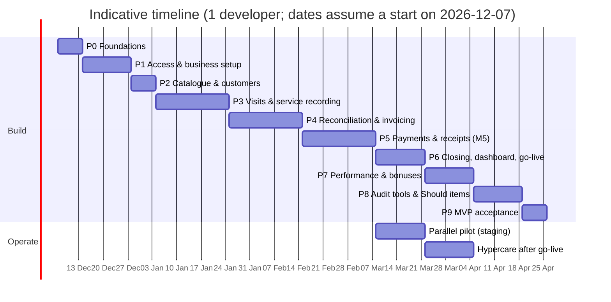
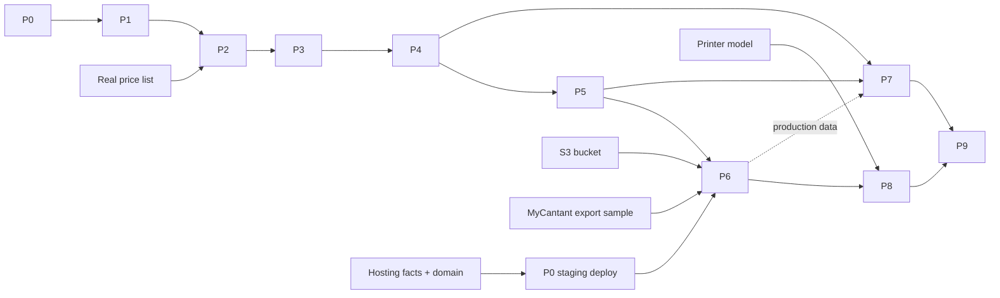

# Stage 4 — Phased Development Roadmap and Delivery Strategy

**Project:** Salon Operations & Accountability Platform
**Version:** 1.2
**Date:** 2026-11-25
**Status:** Approved by the product owner on 2026-11-25. v1.1 adds the owner's approval conditions (§10).

**Baseline:**

- PRD v1.4 and SRS v1.2;
- Stage 2 Technical Design Decisions;
- Stage 3 Implementation Architecture.

All four were approved on 2026-11-25.

---

## 0. Summary

### 0.1 Ten phases, each producing something you can see and use

| Phase | Name | You can demonstrate |
|---|---|---|
| **P0** | Foundations | CI is green. The empty app runs locally and on staging. Calculation engine tests pass. |
| **P1** | Access and business setup | The owner logs in, creates staff, assigns roles and sets up the business and tax. Employees are blocked from admin. |
| **P2** | Catalogue and customers | Services, variants, products and prices are configured. Customers are registered, with a duplicate warning. |
| **P3** | Visits and staff service recording | The desk opens a visit. Staff record their work on their phones, with collaborators. Additional services go through approval. |
| **P4** | Reconciliation, discounts, tax and invoicing | The gate blocks under-billing. Discounts and tax are calculated. The invoice is finalised and printed. |
| **P5** | Payments, receipts, refunds and amendments | **★ M5: the complete workflow works end-to-end on staging.** Part payments, receipts on WhatsApp and email, controlled refunds and an order audit timeline. |
| **P6** | Cashier closing, dashboard, imports and go-live hardening | **★ Release 1: production go-live.** |
| **P7** | Staff performance and bonuses | **Release 2.** Reports reconcile to revenue. Bonuses are calculated, approved and paid. |
| **P8** | Audit tooling and "Should" items | **Release 3, MVP complete.** Audit search, hash chain, shared-device PIN mode, thermal printing, Web Push. |
| **P9** | MVP acceptance and stabilisation | Full PRD §12 acceptance and handover. |

### 0.2 When the product solves your main problem

- **End of P5 (milestone M5).** This is the earliest point at which the whole chain works: customer → visit → staff record their work → staff credit → reconciliation → invoice → payment → receipt → audit trail. At M5, the system runs in a **parallel pilot** on staging next to MyCantant.
- **End of P6 (Release 1).** The salon switches over to the system, because daily cash closing and the owner dashboard are needed to control the money from day one.

### 0.3 Indicative effort

The plan assumes **one full-stack developer, with AI assistance**. It comes to roughly **20 weeks** to MVP completion, with **Release 1 around week 15** (about late March 2027, if work starts on 7 December). The chart below uses an illustrative start date of 7 December 2026; holidays are not included.

These figures are planning estimates only. Each phase plan is re-estimated when it is presented for approval.

---

## 1. Development Principles

1. **Each phase is a working, connected piece.** No phase builds a module that nothing uses. Every phase ends with a working demonstration on staging.
2. **Build the whole workflow, then widen it.** The P3–P5 sequence follows the salon's actual flow, so each phase plugs into the one before it.
3. **Lean foundations.** P0 builds only what every later phase needs: CI, test database, money and percentage types, numbering sequences, idempotency, order locking, audit recorder, module layout, and the frontend shell with authentication plumbing. Nothing speculative.
4. **Tests are written with the feature, not afterwards.** Each phase's Definition of Done includes its SRS §14 scenarios, its permission-matrix rows and its transition tests.
5. **No regressions.** The full test suite runs on every pull request. A phase is complete only when *all* earlier tests still pass.
6. **Every action is audited from the start.** Each Action writes its audit event from the phase it is built in. The audit *user interface* comes later, but the data is never missing.
7. **Approval gate per phase** (§6). I present the plan, you approve it, I implement it and run the tests, I demonstrate it, and I report the results. The next phase starts only after your approval.

---

## 2. Master Roadmap

---

## 3. Phase-by-Phase Plans

Each phase plan below covers the same items:

- objective and business value;
- scope and modules;
- dependencies;
- tasks;
- database, API, frontend and backend deliverables;
- security;
- tests;
- acceptance criteria;
- demonstration;
- risks;
- Definition of Done.

"§14.x" refers to the SRS v1.2 acceptance scenarios.

---

### P0 — Foundations

**Objective.** Put the shared engineering base in place that every later phase relies on.

**Business value.** Indirect. It stops money, locking and audit from being rebuilt inconsistently in each module.

**Scope.** Shared kernel, tooling, CI, environments and the frontend shell.

**Modules.** Shared, Audit (recorder only), frontend `lib/api` and `lib/auth` shells.

**Dependencies.** None. The staging deployment needs the hosting facts (§7). Until they arrive, P0 completes with CI and local environments only.

**Tasks.**

1. Repository:
   - `.github/workflows/ci.yml`, with a backend job (Pint, Larastan, PHPUnit on MySQL 8) and a frontend job (ESLint, `tsc`, Vitest, `next build`);
   - Dependabot and a pull request template.
2. Backend:
   - switch `phpunit.xml` to a MySQL `testing` database, and add `phpunit.unit.xml` for database-free tests;
   - set `.env.example` to MySQL with documented variables;
   - install the approved packages (S2-D03, S3-D02).
3. Create the `app/Domain/` layout and an architecture test for the module dependency rules.
4. Shared kernel:
   - `Money` and `Percentage` value objects with `round_div`;
   - `BusinessDay`;
   - `Sequence` (gap-free, locked);
   - `Idempotency` (table, middleware or helper, replay, mismatch);
   - `OrderLock` contract;
   - `AuditRecorder` and the `audit_events` table (without the hash chain);
   - an exception-to-error-code handler;
   - the API response envelope;
   - request-ID middleware.
5. **`InvoiceCalculator` and `AllocationCalculator`** as pure classes, with the worked examples E1–E6 and property tests. Building these first lowers the riskiest calculation work early.
6. Frontend:
   - `output: 'export'` configuration;
   - `apiFetch` (credentials, XSRF, idempotency key, error normalisation);
   - TanStack Query provider;
   - an `AuthProvider` shell;
   - area layouts `/staff`, `/desk`, `/admin` with placeholders;
   - manifest, icons and a minimal `sw.js` with a post-build precache script;
   - `.htaccess` template.
7. OpenAPI generation (Scramble), the `openapi-typescript` script, and a CI check that the generated types are current.
8. Infrastructure:
   - `infrastructure/docker/compose.yml` (MySQL 8.4, Mailpit) for local work;
   - cPanel `deploy.sh` and `deploy.yml` (staging), if the hosting facts are available;
   - runbook drafts.

**Database changes.** `audit_events`, `idempotency_keys` and `number_sequences`. The existing users, cache and jobs tables are kept.

**API changes.** `GET /up`, plus the response envelope and error format.

**Frontend deliverables.** The app shell, an installable PWA showing placeholder screens, and the API client.

**Backend deliverables.** The kernel, the calculators and the error handling.

**Security considerations.**

- Secure defaults: debug off outside local, CORS locked to the app origin, security headers.
- No secrets in the repository.

**Testing requirements.**

- Unit tests for Money, Percentage, rounding and sequences.
- Calculator E1–E6 and invariants I-1 to I-5, with 1,000+ random cases.
- An idempotency replay test.
- The architecture test.

**Acceptance criteria.**

- CI is green on a pull request.
- The calculator tests pass.
- `next build` produces `out/`.
- The installed PWA opens offline to `offline.html` with no data cached.

**Demonstrable outcome.** The CI run, the calculator test report, and the PWA shell installed on a phone (staging or local).

**Risks and mitigation.**

| Risk | Mitigation |
|---|---|
| Next 16 static export or Turbopack quirks | Spike the export on day 1. The fallback is a webpack build. |
| MySQL in CI is slow | Use a service container and wrap tests in transactions. |

**Definition of Done.** All tasks complete, CI green, README setup steps verified from a fresh clone.

---

### P1 — Access and Business Setup

**Objective.** Individual accounts, roles and permissions, business scope and business settings.

**Business value.** Accountability starts with knowing who did what. The owner controls who can do what.

**Scope.**

- SRS §3: the permission catalogue and default roles.
- §4.1: authentication, except PIN mode.
- §4.2: business settings.
- §4.12: tax settings, configuration only.
- Login lockout, idle timeouts, and audit of permission changes.

**Modules.** Identity, Business, Audit.

**Dependencies.** P0.

**Tasks.**

1. Migrations: `businesses`, `business_user`, spatie permission tables (with teams), role cap columns, `employee_profiles`, `business_settings`, `tax_settings`.
2. Seeders:
   - `PermissionSeeder`, covering every permission in SRS §3.3;
   - `RoleSeeder`, covering the default role matrix and caps;
   - initial business and owner, created by a console command `app:install`.
3. Authentication:
   - Sanctum SPA configuration;
   - `POST /auth/login`, `POST /auth/logout` and `GET /me`;
   - login throttling and lockout (SEC-017);
   - password rules (SEC-019);
   - `EnforceIdleTimeout` middleware (SEC-018);
   - `EnsureBusinessScope` global scope.
4. Users and roles: create, edit, enable and disable users; employee profile; assign roles; edit role permissions and caps. Every change is audited (FR-IAM-006).
5. Settings: business profile and logo; numbering formats; windows (late window, transfer alert, link expiry); tax settings, with version checks and audit.
6. Denied-attempt audit (SEC-016), wired into the exception handler.
7. Frontend:
   - login page;
   - `/me` bootstrap and permission-aware navigation;
   - a landing redirect by role;
   - Admin › Users, Roles and Settings, including the Tax screen.

**Database changes.** Listed in task 1.

**API changes.** `auth/*`, `me`, `users`, `roles`, `settings`, `settings/tax`.

**Frontend deliverables.** Login and the three admin screens.

**Backend deliverables.** Actions for users, roles and settings, plus policies.

**Security considerations.** This phase is security-critical. It is reviewed against SEC-001 to SEC-008 and SEC-014 to SEC-019.

**Testing requirements.**

- A **permission matrix test harness** (each permission × endpoint, allow or deny). Later phases extend it.
- Lockout, idle timeout, disabled-user login (part of §14.22) and business-scope isolation (with a second seeded business).
- §14.10.

**Acceptance criteria.**

- The owner can create a cashier and an employee.
- An employee calling an admin endpoint receives 403, and the attempt is audited.
- After 30 idle minutes, a cashier is logged out.
- Turning tax on or off is audited and visible in Settings.

**Demonstrable outcome.** A live walkthrough on staging, covering the acceptance criteria above.

**Risks and mitigation.**

| Risk | Mitigation |
|---|---|
| Cross-subdomain cookie misconfiguration | A staging smoke test exercises real subdomains early. |

**Definition of Done.** Acceptance met, all tests green, permission seeds documented.

---

### P2 — Catalogue and Customers

**Objective.** Configure what the salon sells, and who it sells to.

**Business value.** Prices are set by the owner, not typed in at the till.

**Scope.**

- SRS §4.4: services, variants, products, taxable flag, quantity flag, allocation defaults.
- SRS §4.3: customers, phone normalisation and duplicate warning.

**Modules.** Catalogue, Customers.

**Dependencies.** P1.

**Tasks.**

1. Migrations: `catalogue_categories`, `catalogue_items` (variants, type, allocation default), `customers`.
2. Catalogue Actions: create, update and deactivate, with optimistic version checks and audited price changes.
3. Customer Actions:
   - create and update;
   - phone normalisation to E.164 (+234);
   - duplicate-phone warning and confirmation;
   - search;
   - `AnonymiseCustomer` (SEC-021).
4. Employee view of the catalogue, with prices removed (BR-041).
5. Frontend: Admin › Catalogue (category tree, variants, products, allocation default editor); Desk › Customers (search, create, duplicate prompt).

**Database changes.** Listed in task 1.

**API changes.** `catalogue/*`, `customers/*`.

**Frontend deliverables.** The Catalogue and Customers screens.

**Backend deliverables.** The Actions, plus the employee and staff resource views.

**Security considerations.**

- `customer.view_contact` hides phone numbers from users who lack it.
- Customer anonymisation is restricted to the owner.

**Testing requirements.**

- Historical price snapshot. This becomes testable in P3, so the fixture is prepared here.
- Duplicate warning.
- Price fields are absent from the employee view.
- Permission rows.

**Acceptance criteria.**

- The owner configures the real price list, including variants such as "Knotless — Medium" and products such as attachment hair.
- The desk registers a customer and is warned when the phone number already exists.

**Demonstrable outcome.** A real-looking catalogue entered on staging.

**Risks and mitigation.**

| Risk | Mitigation |
|---|---|
| The real price list is not available | Ask the owner for it now (§7). Demo data is used until then. |

**Definition of Done.** Acceptance met, tests green.

---

### P3 — Visits and Staff Service Recording

**Objective.** The front desk opens visits, and staff record the services they performed, alone or together.

**Business value.** This is the **first direct attack on revenue leakage**. Every performed service gets an independent, confirmed record.

**Scope.**

- SRS §4.5: orders, items, assignments, adding items, cancelling unexecuted items, price override, cancelling an order.
- §4.6–4.7: execution, joining, editing contributors, allocation override, disputes, corrections, cancellation.
- §4.8: additional-service requests and approval.
- §4.22: in-app notifications.
- SRS §6.1–6.3 transitions, excluding finalisation.

**Modules.** Orders, Execution, Notifications.

**Dependencies.** P2, and the P0 calculators (allocation).

**Tasks.**

1. Migrations: `service_orders`, `order_items`, `order_item_assignments`, `executions` (with the stored generated `active_item_key` column and a unique index), `execution_contributors`, `reconciliation_decisions`, `notifications`.
2. `OrderLock` implementation (`FOR UPDATE`).
3. Order Actions: create, add item, assign, cancel unexecuted item, cancel order.
4. Execution Actions: submit (idempotent), join, edit contributors, override allocation, dispute, dismiss, correct (supersede), cancel. Segregation of duties is enforced.
5. Additional-service request, approve, reject and withdraw.
6. Late-window checks are built in now, and take effect once finalisation exists in P4.
7. Notification listeners for the events in FR-NOT-002, plus the polling endpoint.
8. Frontend:
   - **Desk:** new visit (guest or customer, items and variants, assignment); live board; order page with item and execution status.
   - **Staff:** today's orders; order page with **3-tap submit**; add collaborator; join; dispute; request additional; history.
   - **Admin:** approvals queue (additional services); notifications bell.

**Database changes.** Listed in task 1.

**API changes.** `orders/*`, `order-items/*`, `executions/*`, `notifications/*`.

**Frontend deliverables.** The full employee mobile experience and the desk order flow, without invoicing.

**Backend deliverables.** All Actions in SRS §6.1–6.3 except finalisation.

**Security considerations.**

- Employee responses never include prices or customer contacts (§14.23).
- Segregation of duties on corrections.

**Testing requirements.**

- §14.1 (allocation part), §14.2, §14.3, §14.14 (concurrency), §14.22 (contributor eligibility) and §14.23.
- Transition tests for items and executions.
- A database integrity test: a second active execution is rejected by the database itself.

**Acceptance criteria.**

- Three employees on one braid, using their own phones, produce one execution with three contributors and an equal split.
- A second submission returns "Join".
- An additional service waits for approval.
- A cashier cannot cancel an executed item.

**Demonstrable outcome.** A **live salon rehearsal** on staging, with the desk on a laptop and staff on real phones.

**Risks and mitigation.**

| Risk | Mitigation |
|---|---|
| Staff UX friction | Usability check with 2–3 real staff during the phase. Iterate on the 3-tap flow. |
| Concurrency bugs | The concurrency test suite runs in CI. |

**Definition of Done.** Acceptance met, tests green, short staff walkthrough notes recorded.

---

### P4 — Reconciliation, Discounts, Tax and Invoicing

**Objective.** Turn what was performed into a correct, locked invoice.

**Business value.** **The cashier can no longer under-bill.** Invoice lines come from the system, the finalisation gate blocks premature finalisation, and exceptions need permission.

**Scope.**

- SRS §4.9: R1–R9 and the R4 decision.
- §4.10: preview, finalise, finalise with exception, PDF. Amendments and voids come in P5.
- §4.11: discounts, including over-limit approval.
- §4.12: tax.
- Contribution ledger writes at finalisation (DR-007).
- Late executions after finalisation (R7).

**Modules.** Billing, Performance (ledger writer only), Documents (PDF).

**Dependencies.** P3, plus the P0 calculator.

**Tasks.**

1. Migrations: `discounts`, `approval_requests`, `invoices`, `invoice_revisions`, `invoice_lines`, `finalisation_exceptions`, `exception_reviews`, `contribution_ledger`.
2. `ReconciliationQuery` (R1–R9); the R4 decision Action.
3. Discount Actions:
   - apply within the cap;
   - over-limit approval request, approve, reject and withdraw;
   - spread across lines (DR, FR-DIS-008).
4. `FinaliseOrder`:
   - gate check;
   - displayed-total check;
   - net-paid check (part payments are built in P5, so this is a placeholder of zero);
   - invoice sequence, revision 1 and lines;
   - finalisation exception record;
   - `InvoiceRevisionCreated` event leading to `LedgerWriter`.
5. Late-execution handling (R7, FR-EXE-013) and additional-service requests after finalisation (FR-ADD-011). The approval *amendment* path is completed in P5.
6. Invoice PDF (dompdf, A4).
7. Frontend:
   - **Desk:** reconciliation panel with blocking badges; discounts dialog with request-approval flow; draft invoice; finalise (handles 409 and 422); finalise with exception (permission-gated); invoice view and PDF.
   - **Admin:** approvals for discounts; tax settings already done in P1.

**Database changes.** Listed in task 1.

**API changes.** `reconciliation`, `invoice-preview`, `discounts`, `approvals`, `finalise`, `invoices` (read), `invoices/{id}/pdf`.

**Frontend deliverables.** The full desk billing experience, without payments.

**Backend deliverables.** The Billing module and the ledger writer.

**Security considerations.**

- `invoice.finalise_with_exception` is restricted to supervisors and the owner.
- Segregation of duties on discount approval.
- There are no API routes to edit invoice lines directly (FR-INV-012). A negative test proves this.

**Testing requirements.**

- §14.4, §14.5, §14.12, §14.13, §14.15 (concurrent finalise), §14.18 (historical pricing) and §14.19.
- Invariant tests on real persisted invoices.
- Ledger totals equal line net values.

**Acceptance criteria.**

- An order with an unrecorded service cannot be finalised by a cashier.
- A supervisor exception is recorded and shown.
- 10% invoice discount and 7.5% tax match E3 to the kobo.
- Two simultaneous finalisations produce one invoice.

**Demonstrable outcome.** Finalise real-looking visits with discounts and tax, and print the A4 invoice.

**Risks and mitigation.**

| Risk | Mitigation |
|---|---|
| Calculation edge cases | Covered by P0 property tests. P4 adds persisted-data property tests. |
| dompdf layout limits | Keep the template simple. Review it with the owner early. |

**Definition of Done.** Acceptance met, tests green, invoice template approved by the owner.

---

### P5 — Payments, Receipts, Refunds and Amendments

**Objective.** Record every naira in and out, share receipts, and support controlled corrections after finalisation.

**Business value.** **The complete accountability chain works.** This is the **★ M5** milestone.

**Scope.**

- SRS §4.13: payments before and after finalisation, transfer verification.
- §4.14: receipts, PDF, WhatsApp, email, share links.
- §4.15: reversals and refunds.
- FR-INV-007/013/015/016: amendments with preview, voids.
- FR-ADD-011: completing the approval path for additional services after finalisation.
- Order audit timeline (FR-AUD-010).

**Modules.** Payments, Documents (receipts, links, email), Billing (amend and void), Audit (timeline read).

**Dependencies.** P4.

**Tasks.**

1. Migrations: `payments`, `receipts`, `payment_reversals`, `refunds`, `transfer_verifications`, `shared_document_links`.
2. `RecordPayment` (idempotent; limits before and after finalisation; receipt sequence; transfer Unverified).
3. `ReversePayment`, `IssueRefund`, `VerifyTransfer`, `RejectTransfer` (system reversal tagged for RR-16). Segregation of duties applies.
4. `PreviewAmendment` and `AmendInvoice` (change set; refund when the new total falls below net paid; ledger supersession). `VoidInvoice`. An action that would bring the total below net paid on an Open order requires a refund (FR-PAY-015).
5. Receipt PDF; share link (token, expiry, revoke); public `GET /share/{token}`; queued email via SMTP; WhatsApp share (`navigator.share`, or a `wa.me` link).
6. `BalanceQuery` and the payment status.
7. Order audit timeline endpoint and UI.
8. Frontend:
   - **Desk:** payment panel (method, amount, reference; part payment before finalising); receipt and share; refund and reverse (permission-gated); amendment wizard with preview.
   - **Admin:** transfer verification list.
   - Order audit timeline.
9. **Pilot preparation:** staging seeded with the real catalogue and staff, and a pilot checklist.

**Database changes.** Listed in task 1.

**API changes.** `payments`, `refunds`, `reverse`, `verify` and `reject-transfer`, `receipts/*`, `share/*`, `amendments`, `void`, `orders/{id}/audit`.

**Frontend deliverables.** The full desk money flow, verification, amendments and the timeline.

**Backend deliverables.** The Payments and Documents modules; Billing amendments.

**Security considerations.**

- Cashiers hold no reversal or refund permission.
- Shared links follow SEC-022.
- Email contains no data beyond the document.
- Idempotency on every money call.

**Testing requirements.**

- §14.6, §14.7, §14.11 (end-to-end happy path, in Playwright), §14.16, §14.17, §14.20, §14.25.
- Concurrency: a payment racing an amendment; a duplicate payment replay.

**Acceptance criteria.**

- A full visit runs end-to-end: part payment of ₦10,000, then finalise, then pay the balance by POS, then a receipt on WhatsApp and by email.
- A refund is refused for a cashier.
- An amendment below the amount paid forces a refund.
- The timeline shows every step.

**Demonstrable outcome.** **★ M5: the complete workflow.** Then a **2-week parallel pilot** on staging: the desk mirrors real visits from MyCantant into the system, and staff record their work. The pilot's discrepancy and usability findings feed into P6.

**Risks and mitigation.**

| Risk | Mitigation |
|---|---|
| Email deliverability from shared hosting | Configure SPF and DKIM on the domain. Fall back to WhatsApp sharing. |
| Pilot fatigue for staff | Keep the pilot short. Agree one champion per shift. |

**Definition of Done.** Acceptance met, end-to-end suite green, pilot started and pilot log created.

---

### P6 — Cashier Closing, Owner Dashboard, Imports and Go-live Hardening → **Release 1**

**Objective.** Daily cash control and owner visibility, then **go live in production**.

**Business value.** The salon runs on the new system. Cash, POS and transfers are reconciled every day. The owner sees discrepancies and exceptions.

**Scope.**

- SRS §4.16: cashier closing, including the money-event block after submission (FR-CASH-010).
- §4.19: dashboard, with exceptions and reviews (FR-DASH-001–016), billed and collected revenue, outstanding, unverified transfers, closings, and the transfer exceptions report.
- §4.21: imports for customers and catalogue, used for go-live data migration.
- Audit search (FR-AUD-007).
- Production hardening: backups, monitoring, a security review and a restore drill.

**Modules.** Closing, Reporting (dashboard, revenue, exceptions), Imports, Audit (search).

**Dependencies.** P5. Also needs: the hosting facts, the S3 bucket, a sample MyCantant export, and the production domain and SMTP (§7).

**Tasks.**

1. Migrations: `cashier_closings`, `cashier_closing_lines`, `import_batches`, `import_row_results`.
2. Closing Actions: create draft on the first money event; submit (frozen lines; money events blocked); return; approve; reopen (owner only); `ExpectedCollections` per SRS §7.6.6.
3. Reporting queries: dashboard (FR-DASH-002–015), exceptions with review (FR-DASH-016), revenue report, transfer exceptions, discounts and taxes summary. `EXPLAIN` checks on `LoadSeeder` data.
4. Imports: upload, dry-run validation, row errors, duplicate flags, atomic commit (openspout). Templates downloadable.
5. Audit search screen (`audit.view`).
6. Hardening:
   - `spatie/laravel-backup` to S3, with monitoring;
   - uptime monitor and heartbeat;
   - log retention;
   - security header check;
   - dependency audit;
   - a **security review** (OWASP checklist against SRS §10);
   - **restore drill no. 1**;
   - production `.env` and least-privilege database user;
   - AutoSSL;
   - SPF and DKIM.
7. Go-live (§5): production installation, real data import, staff accounts, training, cutover.
8. Frontend:
   - **Desk:** my closing.
   - **Admin:** closings review; dashboard; exceptions panel; reports; imports; audit search.

**Database changes.** Listed in task 1.

**API changes.** `closings/*`, `dashboard/*`, `exceptions/review`, `reports/*`, `imports/*`, `audit`.

**Frontend deliverables.** Closing, the dashboard and admin tooling.

**Backend deliverables.** The Closing, Reporting and Imports modules; backup configuration.

**Security considerations.**

- A full security review sign-off is required before production.
- Production data never goes to staging.

**Testing requirements.**

- §14.8, the closing block (RR-15), transfer-rejection exclusion (RR-16).
- Dashboard figures equal report figures (FR-DASH-010).
- Import fixtures (valid, invalid, duplicate).
- Performance targets NFR-PERF-001/003 on load data.
- Restore drill recorded.

**Acceptance criteria.**

- A day's closing for two cashiers shows the correct expected amounts by method and flags a −₦2,000 cash discrepancy.
- A submitted closing blocks further payments by that cashier.
- The dashboard billed total equals the sum of invoices.
- The restore drill succeeds within 4 hours.

**Demonstrable outcome.** **★ Release 1 go-live**, followed by 2 weeks of hypercare.

**Risks and mitigation.**

| Risk | Mitigation |
|---|---|
| Hosting limitations found late | Hosting facts are needed by the start of P1 at the latest (§7). VPS fallback (Stage 3 §11.2). |
| Data quality in the MyCantant export | Dry-run imports and cleanup during the P5 pilot. |
| Go-live disruption | Parallel pilot, a cutover checklist and a rollback plan (§5). |

**Definition of Done.** Acceptance met; security review and restore drill signed off; production live; hypercare log open.

---

### P7 — Staff Performance and Bonuses → **Release 2**

**Objective.** Fair, auditable staff performance figures and bonus calculations.

**Business value.** Rewards are based on records that cannot be manipulated, which delivers PRD goals 3 and 6.

**Scope.**

- SRS §4.17: performance reports (participated, allocated and collected value; customers served; solo versus collaborative).
- §4.18: bonus rules (JSON versions), calculation, approval, void, pay, adjustments (RR-13, RR-14), saved collected ratios (FR-BON-021).
- The `LedgerChanged` event leading to `AdjustmentWriter`.

**Modules.** Performance (reports), Bonus.

**Dependencies.** P4 (ledger) and P5 (payments, for the collected basis). Production data from Release 1 makes the demonstration real.

**Tasks.**

1. Migrations: `bonus_rules`, `bonus_rule_versions`, `bonus_calculations`, `bonus_calculation_inputs`, `bonus_adjustments`, `bonus_payments`.
2. Performance queries: own and team views; daily, weekly, monthly and custom periods; provisional versus final figures (FR-PERF-011).
3. Bonus rule editor and validation (period, basis, formula a/b/c, filters, thresholds), with versioning.
4. `BonusEngine` (pure), with worked examples and property tests. `CalculatePeriod`, `Approve`, `Void`, `Pay` (idempotent).
5. `AdjustmentWriter` for ledger changes that touch Approved or Paid calculations; negative carry-forward.
6. Frontend:
   - **Staff:** "My performance".
   - **Admin:** team performance; bonus rules; calculate, review, approve and pay; adjustments view.

**Database changes.** Listed in task 1.

**API changes.** `performance/*`, `bonus-rules/*`, `bonus-calculations/*`.

**Frontend deliverables.** Performance and bonus screens.

**Backend deliverables.** The Bonus module and performance read models.

**Security considerations.**

- Employees see only their own figures.
- Bonus approval and payment are owner-only by default.
- Segregation of duties between calculating and approving.

**Testing requirements.**

- §14.1 (reports), §14.9, §14.21.
- FR-PERF-010: allocated contributions sum to net service revenue.
- E6 examples; tiered and threshold edge cases.

**Acceptance criteria.**

- The owner configures "5% of monthly allocated contribution".
- November's bonuses are calculated from production data and approved.
- One is paid.
- A later correction creates a next-period adjustment.

**Demonstrable outcome.** The first real bonus cycle, run on Release 1 data.

**Risks and mitigation.**

| Risk | Mitigation |
|---|---|
| The owner's bonus schemes do not fit the three formula types (A-08) | Collect the actual schemes at P7 planning. |

**Definition of Done.** Acceptance met, tests green, owner signs off on the bonus figures.

---

### P8 — Audit Tooling and "Should" Items → **Release 3 (MVP complete)**

**Objective.** Finish the remaining MVP capabilities and the "Should" priorities.

**Scope.**

- Audit hash chain and verifier (SEC-024).
- Shared-device PIN mode (FR-AUTH-007).
- 80 mm thermal receipt layout (FR-RCT-008).
- Web Push notifications (FR-NOT-003).
- Customer history screen polish (FR-CUS-010).
- Usability fixes from hypercare.

**Modules.** Audit, Identity, Documents, Notifications.

**Dependencies.** P6. Thermal printer model (A-07). Staff device survey (A-06).

**Tasks.**

1. Hash-chain columns, a backfill job and a daily verifier with an owner alert.
2. Shared devices: registration, PIN set and reset, `pin-switch`, 2-minute auto-lock, lockout (SEC-017).
3. Thermal print route and CSS, tested on the salon's printer.
4. Web Push: VAPID keys, `push_subscriptions`, subscription UI, queued sends. Supported on Android, and on iOS 16.4+ when the app is installed.
5. A backlog of fixes from hypercare, prioritised with the owner.

**Database changes.** `shared_devices`, `push_subscriptions` and the audit hash columns.

**API changes.** `pin-switch`, `devices/*`, `push/*`.

**Frontend deliverables.** PIN screen, print route, push opt-in.

**Backend deliverables.** The items above.

**Security considerations.**

- PIN throttling.
- Device token hashing.
- No personal data or money in push payloads (FR-NOT-004).

**Testing requirements.**

- Hash tamper detection: a test edits a row and the verifier alerts.
- PIN lockout.
- Print layout checked on the device.

**Acceptance criteria.**

- A tampered audit row is detected.
- Staff switch identity on the shared tablet in under 5 seconds.
- A receipt prints correctly on the thermal printer.
- A supervisor receives a push notification for a pending approval.

**Demonstrable outcome.** **Release 3: every PRD §6.1 module delivered.**

**Risks and mitigation.**

| Risk | Mitigation |
|---|---|
| Web Push limits on iOS | In-app notifications remain the primary channel. |

**Definition of Done.** Acceptance met, tests green.

---

### P9 — MVP Acceptance and Stabilisation

**Objective.** Formally accept the MVP against PRD §12 and SRS §14, and hand over.

**Tasks.**

1. Run the complete SRS §14.1–14.25 suite and produce the PRD §12 acceptance checklist with evidence.
2. Performance re-check on production-sized data.
3. Restore drill no. 2.
4. Close the traceability matrix (SRS §17), with a test or demonstration for every requirement.
5. Documentation: user guides per role (one page each), the owner admin guide, and the runbooks (deploy, restore, incident).
6. Final known-issues list and post-launch backlog (§8).

**Acceptance criteria.**

- Every PRD §12 outcome is demonstrated.
- No open Critical or High defects.
- The owner signs off.

**Definition of Done.** Signed acceptance, documentation delivered, Stage 4 closed.

---

## 4. Dependencies and Critical Path

### 4.1 Dependency map

### 4.2 Critical path

**P0 → P1 → P2 → P3 → P4 → P5 → P6 (Release 1).**

Each step needs the previous one:

| Step | Needs |
|---|---|
| Executions | Orders |
| Invoicing | Executions (the gate) |
| Payments | Invoice totals |
| Closing | Payments |

The highest-risk work sits on this path: concurrency and the gate (P3–P4), money (P4–P5) and go-live (P6).

### 4.3 Work that can run in parallel

Relevant if there is more than one developer, or slack time:

| Work | Can run alongside |
|---|---|
| P7 bonus engine (pure calculator and its tests) | P5–P6 |
| P8 thermal layout and PIN mode | Any time after P3 |
| Imports (P6 task 4) | Any time after P2 |
| Invoice and receipt PDF templates | Can be designed during P3 |
| User guides | Drafted during P5 |

### 4.4 Prerequisites, dependencies and risks

| Type | Item | Needed by |
|---|---|---|
| Technical prerequisites | Approved packages; MySQL 8 locally and in CI | P0 |
| Hosting | PHP 8.3, database version, cron, SSH, subdomains, SMTP | Staging by P1; production by P6 |
| Data migration | MyCantant customer and service export; cleaned real price list; staff list | Price list by P2; export by mid-P5 (pilot); final import in P6 |
| External integrations | SMTP account; S3-compatible bucket; uptime monitor; domain DNS (SPF/DKIM) | P5 (SMTP), P6 (the rest) |
| High-risk areas | Concurrency (P3, P4, P5); calculation correctness (P0, P4); cookie authentication across subdomains (P1); cPanel deployment limits (P0/P6); staff adoption (P3, P5 pilot) | Addressed in each phase's risks |

---

## 5. Release, Deployment and Go-live Plan

### 5.1 Milestones

| Milestone | End of | Definition |
|---|---|---|
| M0 | P0 | CI green; calculators proven; PWA shell |
| M1 | P1 | Secure access live on staging |
| M3 | P3 | Staff recording rehearsed with real staff |
| M4 | P4 | Correct, locked invoices |
| **★ M5** | P5 | Complete workflow end-to-end; parallel pilot starts |
| **★ R1** | P6 | Production go-live |
| R2 | P7 | Performance and bonuses live |
| R3 | P8 | MVP feature-complete |
| MVP-A | P9 | MVP formally accepted |

### 5.2 Release strategy

- **Branching.** `main` is always deployable. Short-lived feature branches go through pull requests, and CI must be green to merge.
- **Versioning.** Releases are tagged `v1.0.0` (R1), `v1.1.0` (R2), `v1.2.0` (R3), then patch versions.
- **Release notes.** Each release has short release notes in plain language for the owner.
- **Process.**
  1. Deploy to staging.
  2. Run the end-to-end suite and a smoke test.
  3. The owner looks at the change on staging, for user-visible changes.
  4. Run the production deployment manually.
  5. Run the post-deploy smoke test.
- **Rollback.** Switch the `current` symlink back to the previous release. Migrations are backward compatible, so this is safe.
- **Timing.** Production deployments happen outside salon opening hours.

### 5.3 Go-live plan (Release 1)

**T−10 days: preparation**

- Production hosting, domain and SSL ready.
- Backups verified with restore drill no. 1.
- Security review signed off.
- Owner account created.

**T−7 days: data**

- Final catalogue and prices imported and checked by the owner.
- Customers imported from MyCantant (dry run, then commit).
- Staff accounts and roles created.
- Tax setting confirmed.
- Numbering formats set.
- Receipt footer and logo configured.

**T−5 to T−2 days: training**

- 30 minutes per role: employees (phone install and the 3-tap submit), cashiers (visit to closing), supervisors (approvals, corrections, refunds), owner (dashboard, verification, closings).
- One-page role guides handed out.

**T−1 day: readiness check**

- Each staff member logs in on their device and submits a test service on a training visit.
- Training data is cleaned up by voiding or cancelling it. This is audited.

**Cutover day**

- New visits start in the new system from opening time.
- MyCantant is kept *read-only* for history and for visits already in progress.
- The developer is on call during opening hours.

**Rollback criteria**

If a blocking defect stops billing for more than 1 hour, the desk falls back to MyCantant for invoicing. Staff still record their work in the new system, so no accountability data is lost. The fix is deployed, and the desk returns.

**Hypercare (2 weeks)**

- Daily check of the dashboard exceptions, closings and error logs.
- Defects triaged within 1 business day; Critical defects fixed the same day.
- A short weekly review with the owner.

**Exit criteria**

- 10 consecutive business days with no Critical or High defects.
- Every closing completed.
- The owner confirms.

### 5.4 Testing and quality strategy across phases

| Gate | Applies | Must pass |
|---|---|---|
| Pull request | Every change | Pint, Larastan, ESLint, `tsc`, unit and feature tests, the permission matrix, the architecture test, OpenAPI types current, `composer audit` and `pnpm audit` (no high-severity issues) |
| Phase completion | End of each phase | All of the above, plus the phase's SRS §14 scenarios, concurrency tests touched by the phase, end-to-end tests for completed flows, and the demonstration on staging |
| Release | R1, R2, R3 | Phase gates, plus the full end-to-end suite, performance checks (NFR-PERF), the security checklist (R1 full; R2 and R3 delta), and backup verification |
| MVP acceptance | P9 | The full PRD §12 checklist with evidence, restore drill no. 2, and the traceability matrix closed |

**Defect severity:**

| Severity | Definition | Rule |
|---|---|---|
| Critical | Wrong money, a lost record, or a security breach | Blocks a release; hotfix immediately |
| High | A workflow is blocked with no workaround | Blocks a release |
| Medium | A workaround exists | Scheduled |
| Low | Cosmetic | Backlog |

---

## 6. Phase Approval Protocol

For every phase, P0 to P9:

1. **Plan.** I present a detailed plan for that phase: final task list, estimate, open questions, and anything that changed since this roadmap.
2. **Approval.** You approve it, or change it.
3. **Build.** I implement only the approved scope, on a feature branch, with tests written alongside the code.
4. **Test.** I run the full suite and the phase's scenarios, and report the actual results, including any failures.
5. **Demonstrate.** On staging, or locally before staging exists.
6. **Report.** Test results, known limitations, deviations from the plan, and any proposed requirement changes. Those changes go through the change process: a PRD or SRS version update with your approval.
7. **Document.** Update the README, the runbooks and the traceability matrix. Commit and merge only with your agreement.
8. **Request approval** to start the next phase. **I will never start the next phase automatically.**

---

## 7. What I Need From You, and When

| Item | Needed by | Why |
|---|---|---|
| Hosting facts (PHP version, database version, cron, SSH, subdomains, SMTP) | **Start of P1** (staging) | Deployment approach, cookie domains |
| Domain name and DNS access | Start of P1 | `app.` and `api.` subdomains, SSL |
| Real price list (services, variants, products) | P2 | Catalogue setup and realistic testing |
| 2–3 staff willing to try the phone flow | P3 | Usability check |
| Invoice and receipt details (business name, address, footer, bank details shown, logo) | P4 | PDF templates |
| Sample MyCantant export (customers and services) | Mid-P5 | Import mapping, pilot |
| S3-compatible storage account (Backblaze B2 or Cloudflare R2) | P6 | Off-site backups |
| Actual bonus schemes (A-08) | P7 planning | Rule configuration |
| Thermal printer model, if any (A-07); staff device situation (A-06) | P8 planning | Print layout, PIN mode priority |

---

## 8. Post-launch Priorities (after MVP acceptance)

Ranked by value to the business and by how closely they follow the current architecture:

1. **Controlled offline submissions for staff,** using IndexedDB with idempotency keys. The idempotency design already supports this.
2. **WhatsApp Business API** delivery of receipts, and reminders for outstanding balances.
3. **Payment gateway or bank transfer confirmation integration** (for example, a virtual account per order), so transfers verify themselves.
4. **Attendance and scheduling** (PRD future scope).
5. **Inventory for products and attachments,** building on the existing Product item type.
6. **Multi-branch:** adding `branch_id`, branch-scoped roles and reports (DR-004 prepared for this).
7. **Cleaning-service module,** reusing customers, catalogue, orders, execution, billing and payments, plus job location and scheduling.
8. **Expenses and profit reporting;** a payroll and commission engine.
9. **Cash-basis collected contribution,** if wanted (S2-D06 option B).
10. **Moving to a VPS** when load or features require it (Stage 3 §11.2). No code change is needed.

---

## 9. Approval Request

Please respond with one of the following:

- **"Approve Stage 4"**. The roadmap becomes the delivery plan. I will then present the **detailed P0 plan**. P0 implementation starts only after you approve that phase plan.
- **Approve with changes.** For example, change the phase order, merge phases, or change the release points.
- **Request clarification.**

It would also help to send the **hosting facts and domain** (§7) when you can. They are needed by the start of P1.

---

## 10. Changes on Approval (v1.1, 2026-11-25)

The owner approved Stage 4 with two instructions. These **override** any earlier text in this document that conflicts with them.

### 10.1 The owner performs all deployments

**What changes.** Hosting facts and the domain name are **no longer required** from the owner. They are removed from §4.4 and §7.

**My responsibility instead.** Ship deployment artefacts and scripts that are **proven to work** on the target platforms.

- **Release artefacts, built by CI.** These are attached to every tagged GitHub Release:
  - `bizzmag-api-<version>.tar.gz`: the Laravel app with production `vendor/`, no `.env` and no tests;
  - `bizzmag-app-<version>.tar.gz`: the static frontend `out/`, with `.htaccess`.
- **Two ways to deploy:**
  - (a) `infrastructure/cpanel/deploy.sh` and `infrastructure/vps/deploy.sh`, with an atomic release and symlink switch, for use over SSH;
  - (b) a no-SSH path: upload through the cPanel File Manager and run the steps through cPanel Terminal or cron. Both paths are documented step by step in `docs/runbooks/`.
- **`php artisan app:preflight`.** The owner runs this on the host. It checks:
  - PHP version and extensions;
  - database engine and version, including whether `CHECK` constraints and generated columns actually work;
  - writable paths;
  - `APP_KEY`;
  - consistency of the session, Sanctum and CORS domains;
  - how recently cron last ran (heartbeat);
  - queue tables;
  - UTC timezone.

  The output is a plain pass/fail list.
- **Deployment verification in CI.** Every release candidate is deployed *by the same scripts* into two containerised copies of the target platforms:
  - **cPanel-like:** Apache 2.4 with `mod_rewrite` and `.htaccess`, PHP 8.3, MariaDB 10.6 (the minimum supported version), `app.`/`api.` virtual hosts and a cron container;
  - **VPS-like:** Nginx, PHP-FPM 8.3, MySQL 8.4 and a supervisor-run queue worker.

  Smoke tests then check:
  - `/up`;
  - that frontend routes load from a deep link;
  - the CORS preflight;
  - cookie login (from P1 onwards);
  - one critical workflow per completed phase;
  - `app:preflight` passing;
  - migrating forward, rolling back the symlink, and migrating forward again.

  **This lets me state that a release deploys correctly without having access to your host.**
- **Demonstrations** happen locally (I will share screenshots and results), or on your own deployment of the release.
- **Effect on the plan.** P0 gains about 2–3 days for the verification harness and preflight. The total becomes about **20.5 weeks**, and Release 1 moves to about **week 15.5**.

### 10.2 Realistic Nigerian demo data

**What changes.** Every phase extends a **Nigerian demo dataset**, so you can test each phase yourself.

- **Command:** `php artisan app:demo --fresh` (local or staging only; refused in production).
- **Business.** A fictional salon, *"Adunni Hair & Beauty Studio, Admiralty Way, Lekki Phase 1, Lagos"*. The timezone is Africa/Lagos and the currency NGN. Tax is off by default; a VAT 7.5% variant of the data is available.
- **Staff.** About 10 staff with Nigerian names, covering every role:
  - owner;
  - supervisor;
  - two cashiers;
  - braiders, nail technicians, a pedicurist, a lash/makeup artist and an apprentice.

  The demo logins (password and PIN) are listed in `docs/demo-data.md`.
- **Catalogue.** Plausible Lagos mid-range prices, which you can edit:
  - braiding variants (knotless, box braids, cornrows, Ghana weaving; small/medium/large);
  - wig installs and frontal units;
  - silk press, relaxer and treatment;
  - manicure, pedicure, gel and acrylic nails;
  - lashes and makeup;
  - products (attachment hair packs, edge control, hair cream).
- **Customers.** About 150 **fictional** customers with Nigerian names and correctly formatted +234 mobile numbers, generated from non-assigned patterns. Some share a phone number, to exercise the duplicate warning. Guests are included.
- **Activity history.** About 90 days, added phase by phase as the tables exist. It includes:
  - weekend peaks and "owambe Saturday" rushes;
  - collaborative braids;
  - extra services requested on the floor;
  - part payments;
  - cash, POS and transfer payments, with references in the style of Moniepoint, OPay, GTBank, Access and Kuda;
  - unverified and rejected transfers;
  - a cashier closing shortfall;
  - a disputed execution;
  - a finalisation with exception;
  - refunds;
  - a month of bonus data.
- **Guarantee.** No real people or contacts are used. Every name and number is fictional.

### 10.3 Additional notes (v1.2, 2026-11-25)

**Vercel is a supported frontend target**, alongside cPanel and VPS.

- The same static artefact (`out/`) is used everywhere. `vercel.json` carries the routing and security headers.
- Login requires the Vercel production site to use a **custom subdomain of the API's domain**. `*.vercel.app` and preview URLs cannot log in, because of the cookie-session design (S2-D02).
- CI validates the Vercel configuration. The owner's first Vercel deployment is the final live check.
- This is consistent with Stage 3 TDR-05 option C and SRS NFR-PORT-006.

**Source control.** The owner commits and pushes. At the end of each phase I deliver a **commit plan**: files grouped into logical commits, each with a ready commit message. Approval protocol step 7 (§6) changes accordingly. GitHub Actions results are reviewed after the owner pushes.
