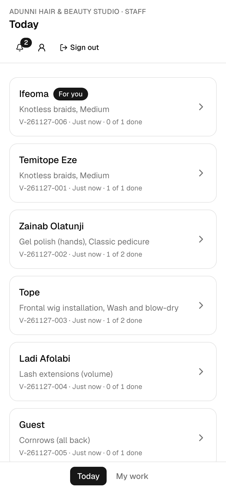
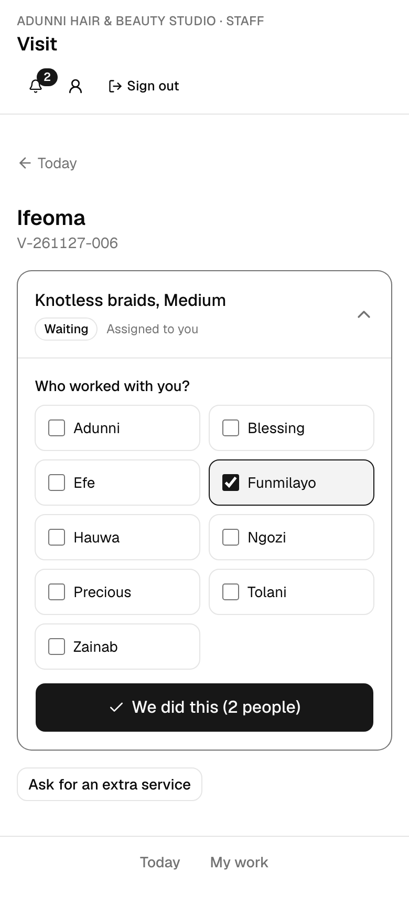
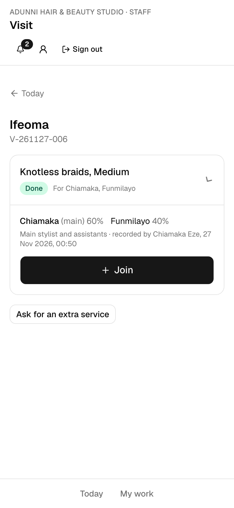

# Recording your work on your phone

For stylists, braiders, nail and lash technicians. One page.

## Before your first day

1. Open the salon's web address on your phone and sign in with your email or phone number and the password the owner gave you. You will be asked to choose your own password.
2. In your browser menu, choose **Add to Home screen**. The app then opens like any other app.

## When you finish a service

1. Open the app. **Today** shows the open visits. Visits with work assigned to you are at the top, marked **For you**.
2. Tap the customer's visit.
3. Tap the service you did, then tap **I did this**.

That is all. You will see "Recorded. Thank you."

## When you worked with someone

Tap **With colleagues**, tick the people who worked with you, then tap **We did this**. They are told on their phones. You are the main person; the credit is shared the way the owner set it for that service.

If a colleague already recorded it, you see "Someone has just recorded this" and a **Join** button. Tap **Join** to add yourself.

## If something is wrong

- **You are on a record you did not work on**, or the people are wrong: open it and tap **Something is wrong**. Say what happened. A supervisor will look at it.
- **You recorded it and forgot someone**: open it and use **Change who worked on it**.
- **The customer wants something extra**, such as a wash: use **Ask for an extra service**. A supervisor approves it. You can do the work while you wait.

## Good to know

- You never see prices, the bill or customers' phone numbers. That is on purpose.
- If your signal drops, tap again. The app makes sure the work is recorded once.
- The bell at the top shows what concerns you: being added to work, decisions on your requests, disputes.
- **My work** lists everything you are credited on, with your share.

---

## For the owner: the live rehearsal

Run this on your staging site with the desk on a laptop and 3 staff on their own phones. It takes about 30 minutes.

1. The desk opens a visit for a guest with **Cornrows (all back)** and assigns one stylist.
2. All three staff open the visit. The assigned stylist taps **I did this**. The other two tap **I did this** too: they should each be offered **Join**, and join.
3. The desk opens the visit: one record, three people, 33.34%, 33.33%, 33.33%.
4. One stylist asks for an extra **Wash and blow-dry**. The supervisor approves it in **Approvals**. The stylist sees the decision under the bell.
5. One stylist disputes the record. A different supervisor dismisses the dispute or corrects it.
6. The cashier tries to remove the recorded cornrows: there is no button for it.

Write down anything that was confusing or slow, and who found it so. Send me the notes; I change the screens before Phase 4.

### Usability check (20 minutes, 2 or 3 staff)

Give each person a phone signed in as themselves and ask them, without help, to:

1. Record a service they did alone.
2. Record a service done with a colleague.
3. Join a service a colleague recorded.
4. Say that a record is wrong.

For each task note: did they finish, how many taps, where they hesitated, and what they said.
